# MapEvolve image benchmark: queries and answer key

AI-drafted labels; human review pending. See README.md for scoring and limitations.

## MEI-LI-001 · landmark_identification · easy

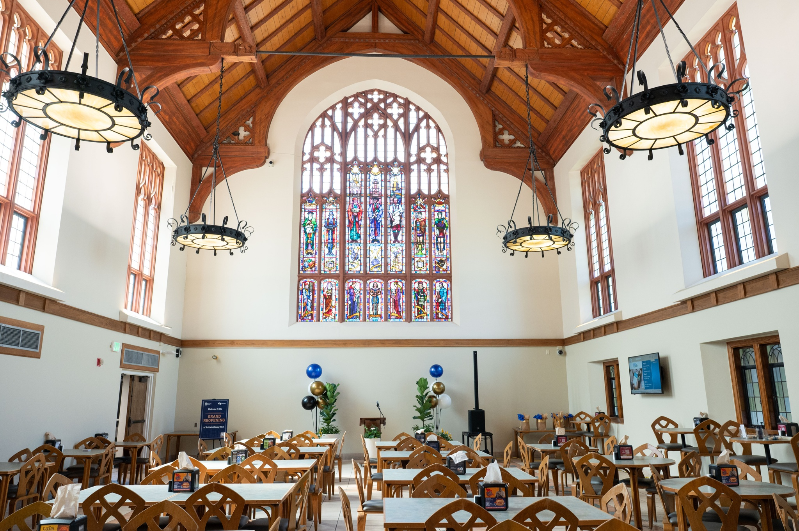

**Question:** Which Georgia Tech dining hall is shown in this interior photograph?

**Supplied evidence:** None (image only)

**Answer key:** Brittain Dining Hall. Visible cues: Large stained-glass window and timber-truss dining room.

**Required points:**
- Identify Brittain Dining Hall; accept these aliases: Marion L. Brittain Dining Hall, Brittain.

**Source:** MapEvolve_Images/Brittain_Dining_Hall/2026-08-12-P1-001.jpg

## MEI-LI-002 · landmark_identification · moderate

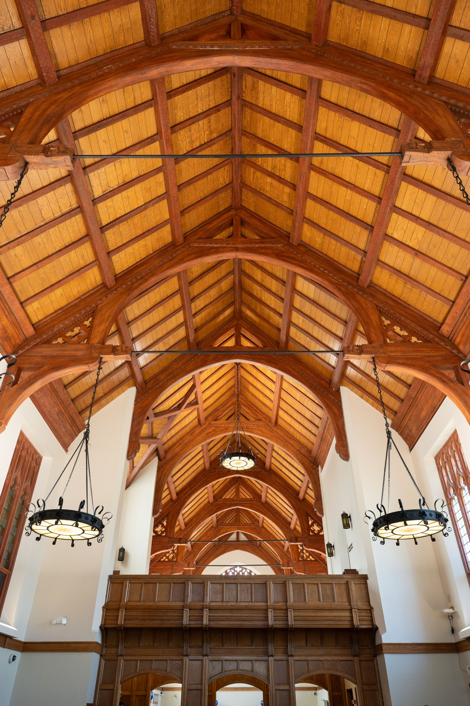

**Question:** Which dining hall contains this long timber-roofed room?

**Supplied evidence:** None (image only)

**Answer key:** Brittain Dining Hall. Visible cues: Long vaulted hall, timber roof, and arched window at the far end.

**Required points:**
- Identify Brittain Dining Hall; accept these aliases: Marion L. Brittain Dining Hall, Brittain.

**Source:** MapEvolve_Images/Brittain_Dining_Hall/2026-08-12-P1-002.jpg

## MEI-LI-003 · landmark_identification · easy

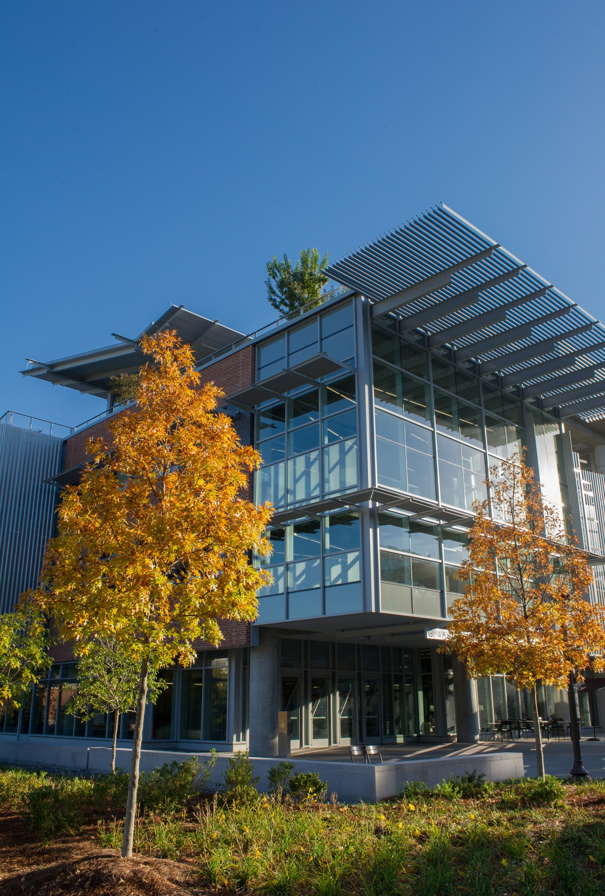

**Question:** Which building is this glass-fronted Georgia Tech learning facility?

**Supplied evidence:** None (image only)

**Answer key:** G. Wayne Clough Undergraduate Learning Commons. Visible cues: Glass corner facade and projecting roof sunshades.

**Required points:**
- Identify G. Wayne Clough Undergraduate Learning Commons; accept these aliases: Clough Commons, Clough, CULC.

**Source:** MapEvolve_Images/Clough/13C4114-P1-028.jpg

## MEI-LI-004 · landmark_identification · moderate

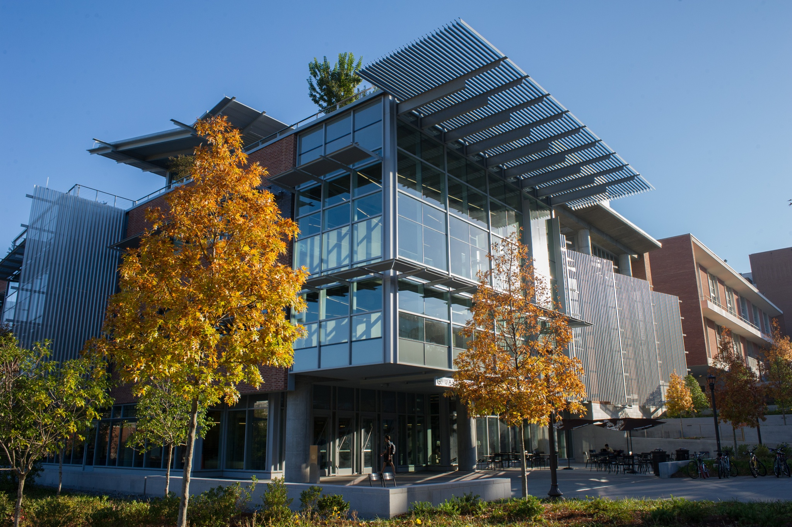

**Question:** Name the campus building behind the autumn trees.

**Supplied evidence:** None (image only)

**Answer key:** G. Wayne Clough Undergraduate Learning Commons. Visible cues: Layered glass facade, roof shades, and brick side wall.

**Required points:**
- Identify G. Wayne Clough Undergraduate Learning Commons; accept these aliases: Clough Commons, Clough, CULC.

**Source:** MapEvolve_Images/Clough/13C4114-P1-029.jpg

## MEI-LI-005 · landmark_identification · moderate

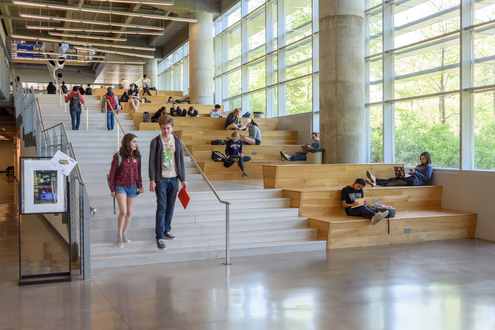

**Question:** Which building contains these broad steps and wooden tiered seating?

**Supplied evidence:** None (image only)

**Answer key:** G. Wayne Clough Undergraduate Learning Commons. Visible cues: Clough Commons signature staircase and wood study terraces.

**Required points:**
- Identify G. Wayne Clough Undergraduate Learning Commons; accept these aliases: Clough Commons, Clough, CULC.

**Source:** MapEvolve_Images/Clough/18C10302-P65-005.jpg

## MEI-LI-006 · landmark_identification · hard

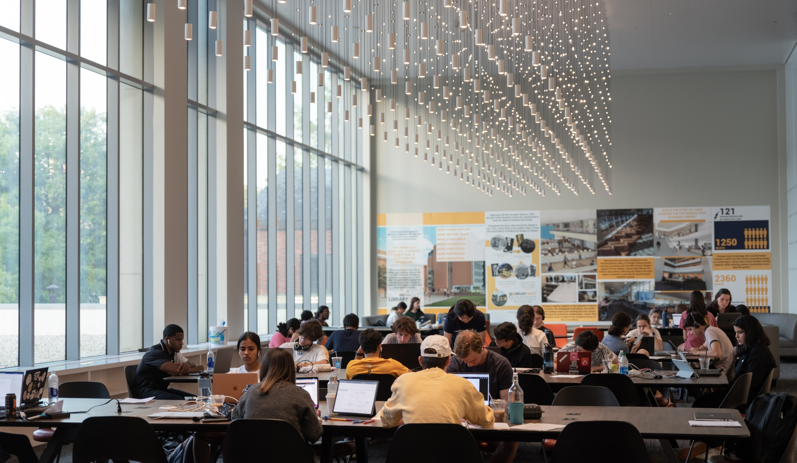

**Question:** Identify the building containing this window-lined study space, if you can.

**Supplied evidence:** None (image only)

**Answer key:** G. Wayne Clough Undergraduate Learning Commons. Visible cues: Study tables, tall windows and suspended linear lights; interior is less distinctive.

**Required points:**
- Identify G. Wayne Clough Undergraduate Learning Commons; accept these aliases: Clough Commons, Clough, CULC.

**Source:** MapEvolve_Images/Clough/22C10400-P10-010.jpg

## MEI-LI-007 · landmark_identification · hard

**Question:** Which campus building contains this study area viewed from above?

**Supplied evidence:** None (image only)

**Answer key:** G. Wayne Clough Undergraduate Learning Commons. Visible cues: Study seating under a dense hanging-light installation; limited exterior context.

**Required points:**
- Identify G. Wayne Clough Undergraduate Learning Commons; accept these aliases: Clough Commons, Clough, CULC.

**Source:** MapEvolve_Images/Clough/22C10400-P10-026.JPG

## MEI-LI-008 · landmark_identification · hard

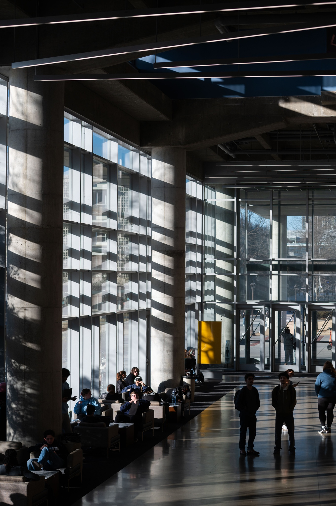

**Question:** Which building contains this shadowed glass-walled atrium?

**Supplied evidence:** None (image only)

**Answer key:** G. Wayne Clough Undergraduate Learning Commons. Visible cues: Tall glass wall, concrete columns, and study terraces.

**Required points:**
- Identify G. Wayne Clough Undergraduate Learning Commons; accept these aliases: Clough Commons, Clough, CULC.

**Source:** MapEvolve_Images/Clough/26-R10410-P96-002.JPG

## MEI-LI-009 · landmark_identification · hard

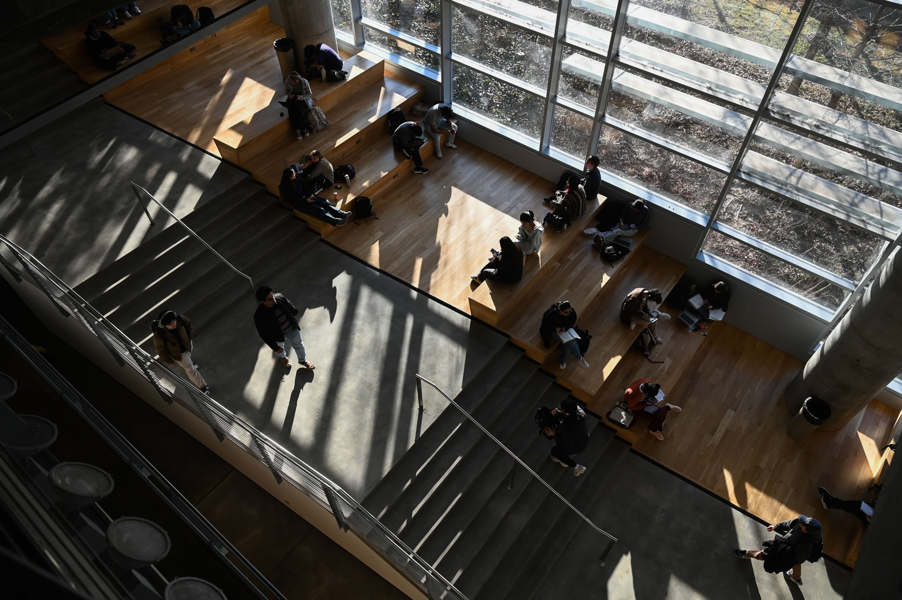

**Question:** Identify the building from this high-angle view of its interior steps.

**Supplied evidence:** None (image only)

**Answer key:** G. Wayne Clough Undergraduate Learning Commons. Visible cues: Broad stair and wooden seating alongside the glass wall.

**Required points:**
- Identify G. Wayne Clough Undergraduate Learning Commons; accept these aliases: Clough Commons, Clough, CULC.

**Source:** MapEvolve_Images/Clough/26-R10410-P96-007.JPG

## MEI-LI-010 · landmark_identification · moderate

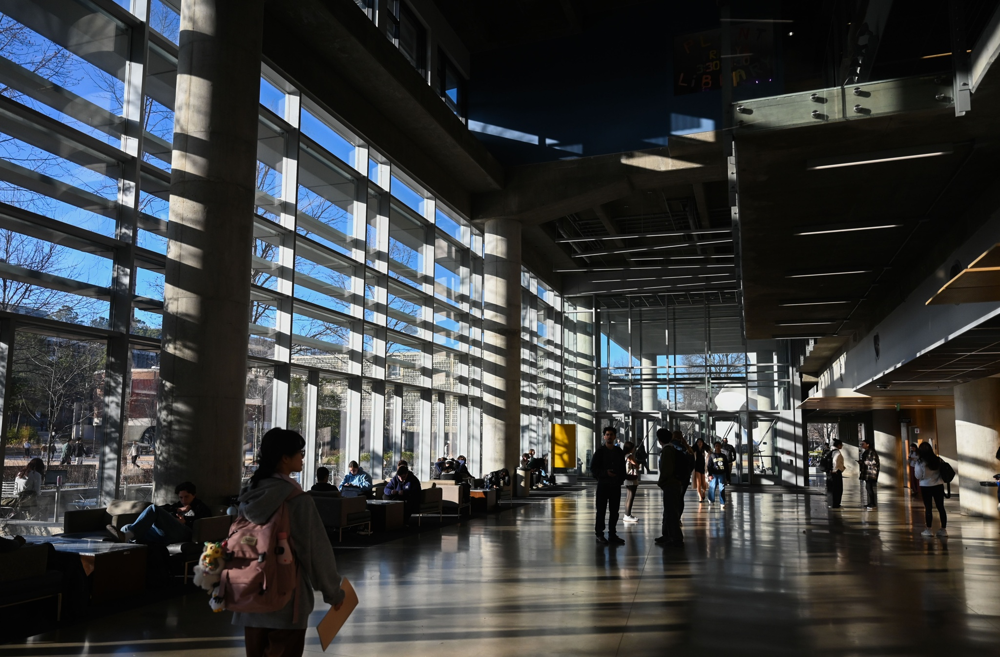

**Question:** Name the Georgia Tech building containing this sunlit tiered study hall.

**Supplied evidence:** None (image only)

**Answer key:** G. Wayne Clough Undergraduate Learning Commons. Visible cues: Distinctive stepped wood seating and tall glazed atrium.

**Required points:**
- Identify G. Wayne Clough Undergraduate Learning Commons; accept these aliases: Clough Commons, Clough, CULC.

**Source:** MapEvolve_Images/Clough/26-R10410-P96-010.JPG

## MEI-LI-011 · landmark_identification · easy

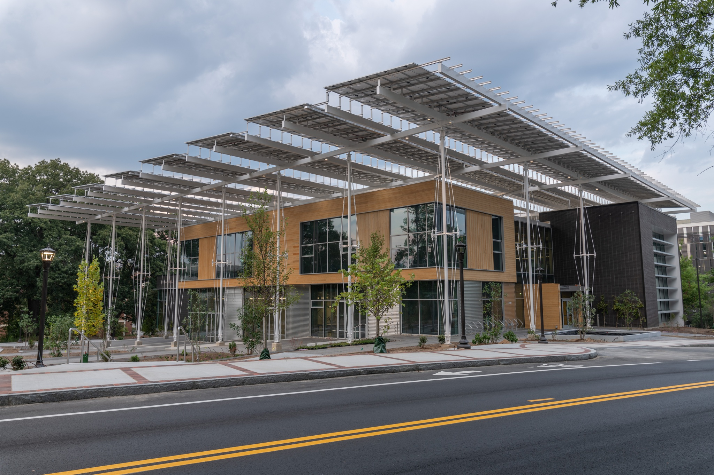

**Question:** Which Georgia Tech sustainability building is this?

**Supplied evidence:** None (image only)

**Answer key:** Kendeda Building for Innovative Sustainable Design. Visible cues: Large photovoltaic canopy above a low timber-and-glass building.

**Required points:**
- Identify Kendeda Building for Innovative Sustainable Design; accept these aliases: The Kendeda Building, Kendeda.

**Source:** MapEvolve_Images/Kendeda/20C10400-P24-001.jpg

## MEI-LI-012 · landmark_identification · moderate

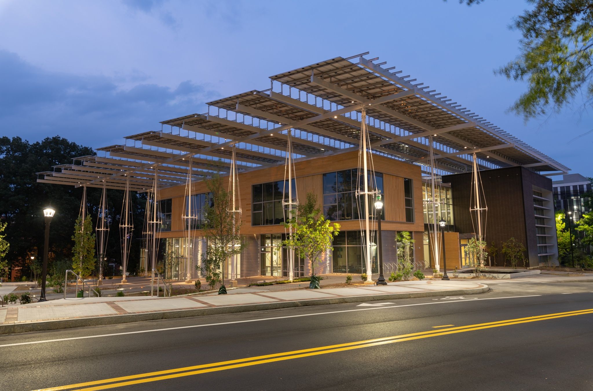

**Question:** Identify this low-rise campus building in the evening.

**Supplied evidence:** None (image only)

**Answer key:** Kendeda Building for Innovative Sustainable Design. Visible cues: Broad solar canopy and illuminated timber/glass facade.

**Required points:**
- Identify Kendeda Building for Innovative Sustainable Design; accept these aliases: The Kendeda Building, Kendeda.

**Source:** MapEvolve_Images/Kendeda/20C10400-P24-002.jpg

## MEI-LI-013 · landmark_identification · moderate

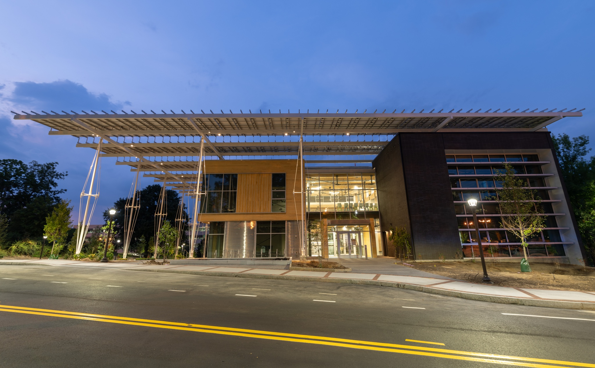

**Question:** What is the name of this campus building viewed across the road at dusk?

**Supplied evidence:** None (image only)

**Answer key:** Kendeda Building for Innovative Sustainable Design. Visible cues: Wide solar canopy over the low-rise building.

**Required points:**
- Identify Kendeda Building for Innovative Sustainable Design; accept these aliases: The Kendeda Building, Kendeda.

**Source:** MapEvolve_Images/Kendeda/20C10400-P24-003.jpg

## MEI-LI-014 · landmark_identification · hard

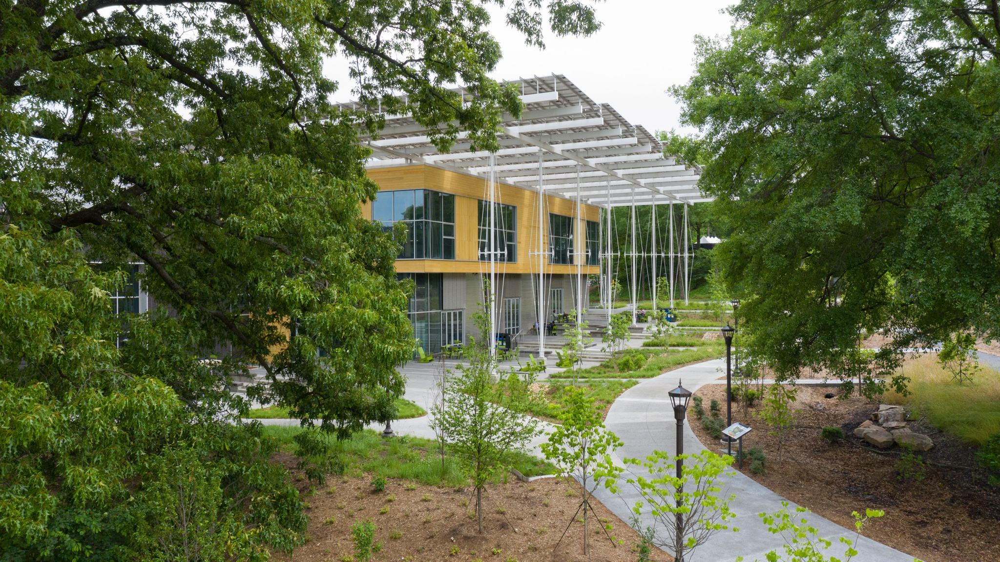

**Question:** Which building is partly hidden behind this landscaped garden?

**Supplied evidence:** None (image only)

**Answer key:** Kendeda Building for Innovative Sustainable Design. Visible cues: Solar canopy and low-rise glazed facade are visible through vegetation.

**Required points:**
- Identify Kendeda Building for Innovative Sustainable Design; accept these aliases: The Kendeda Building, Kendeda.

**Source:** MapEvolve_Images/Kendeda/22C10400-P31-001.jpg

## MEI-LI-015 · landmark_identification · moderate

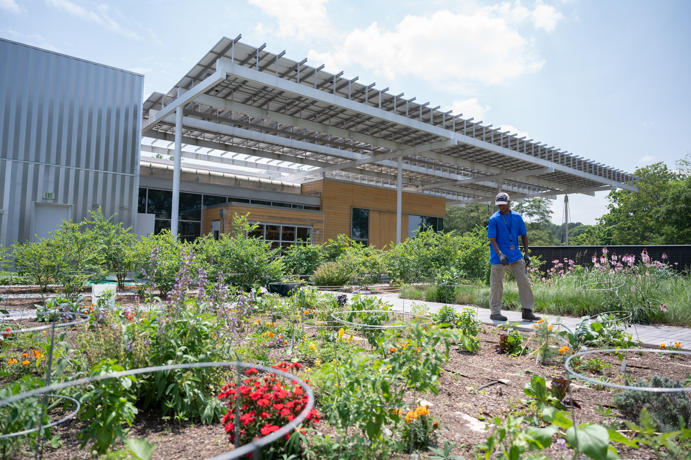

**Question:** Which building stands behind this planted rooftop garden?

**Supplied evidence:** None (image only)

**Answer key:** Kendeda Building for Innovative Sustainable Design. Visible cues: Vegetated roof area and photovoltaic canopy.

**Required points:**
- Identify Kendeda Building for Innovative Sustainable Design; accept these aliases: The Kendeda Building, Kendeda.

**Source:** MapEvolve_Images/Kendeda/23-R10400-P72-001.jpg

## MEI-LI-016 · landmark_identification · hard

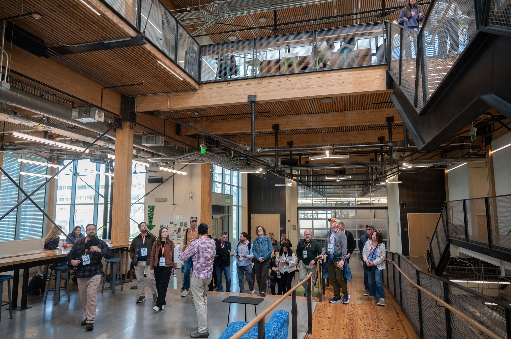

**Question:** Identify the building from this timber-framed interior view.

**Supplied evidence:** None (image only)

**Answer key:** Kendeda Building for Innovative Sustainable Design. Visible cues: Exposed timber frame, interior stairs and mezzanine.

**Required points:**
- Identify Kendeda Building for Innovative Sustainable Design; accept these aliases: The Kendeda Building, Kendeda.

**Source:** MapEvolve_Images/Kendeda/26-R10410-P108-001.JPG

## MEI-LI-017 · landmark_identification · hard

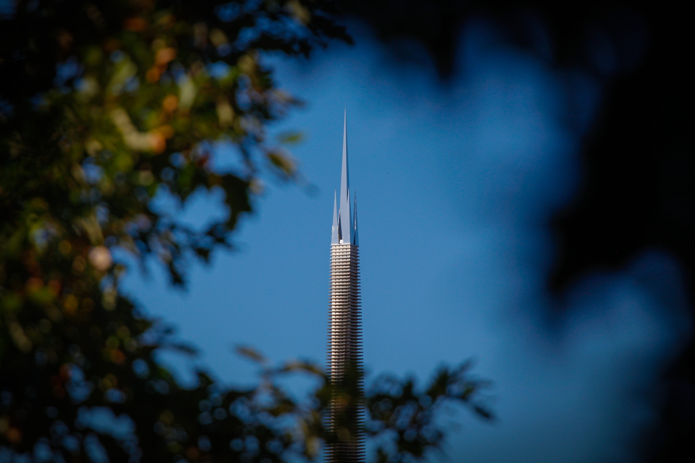

**Question:** What is the name of the slender campus landmark visible through the blurred leaves?

**Supplied evidence:** None (image only)

**Answer key:** Kessler Campanile. Visible cues: Narrow metallic spire partially framed by out-of-focus foliage.

**Required points:**
- Identify Kessler Campanile; accept these aliases: Kessler Campanile Fountain.

**Source:** MapEvolve_Images/Kessler_Campanile/22C10400-P3-008.JPG

## MEI-LI-018 · landmark_identification · easy

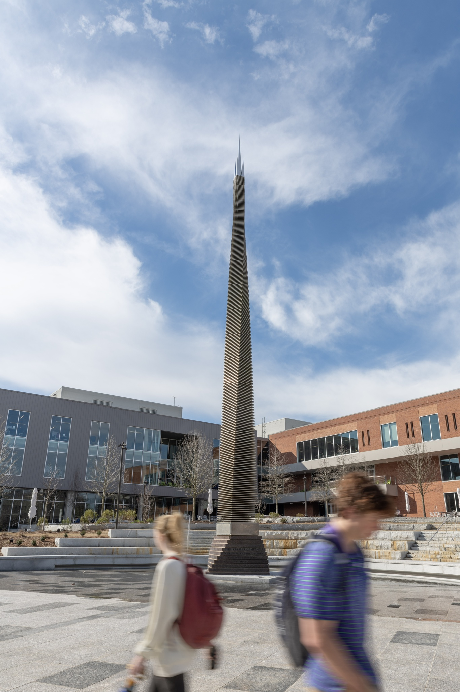

**Question:** Name the tall sculptural landmark in this campus plaza.

**Supplied evidence:** None (image only)

**Answer key:** Kessler Campanile. Visible cues: Freestanding tapering metal campanile.

**Required points:**
- Identify Kessler Campanile; accept these aliases: Kessler Campanile Fountain.

**Source:** MapEvolve_Images/Kessler_Campanile/24-R10400-P11-001.jpg

## MEI-LI-019 · landmark_identification · easy

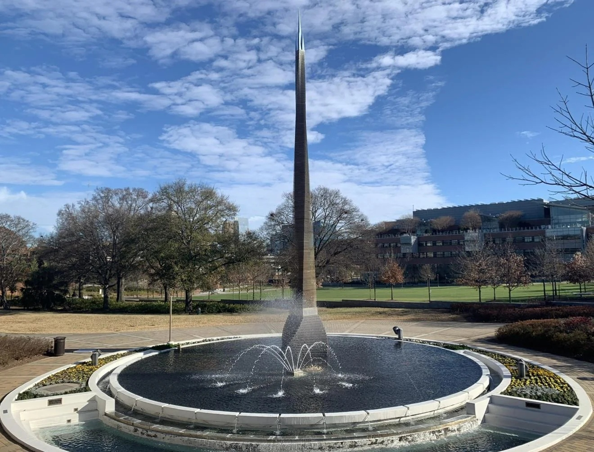

**Question:** What is the name of this tower-and-fountain landmark?

**Supplied evidence:** None (image only)

**Answer key:** Kessler Campanile. Visible cues: Tapering metal spire rising from a circular fountain.

**Required points:**
- Identify Kessler Campanile; accept these aliases: Kessler Campanile Fountain.

**Source:** MapEvolve_Images/Pilot_Pairs/M2_A.jpg

## MEI-LI-020 · landmark_identification · moderate

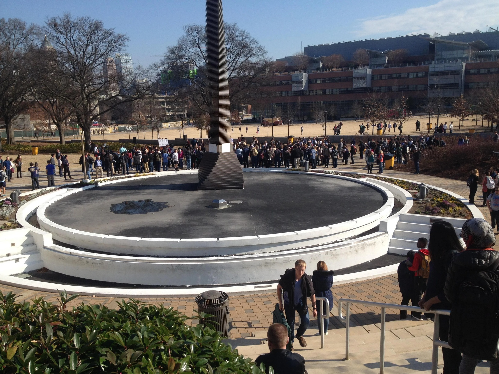

**Question:** Identify the central campus landmark beyond the crowd.

**Supplied evidence:** None (image only)

**Answer key:** Kessler Campanile. Visible cues: Metal spire and circular basin seen from above.

**Required points:**
- Identify Kessler Campanile; accept these aliases: Kessler Campanile Fountain.

**Source:** MapEvolve_Images/Pilot_Pairs/M2_B.jpg

## MEI-LI-021 · landmark_identification · hard

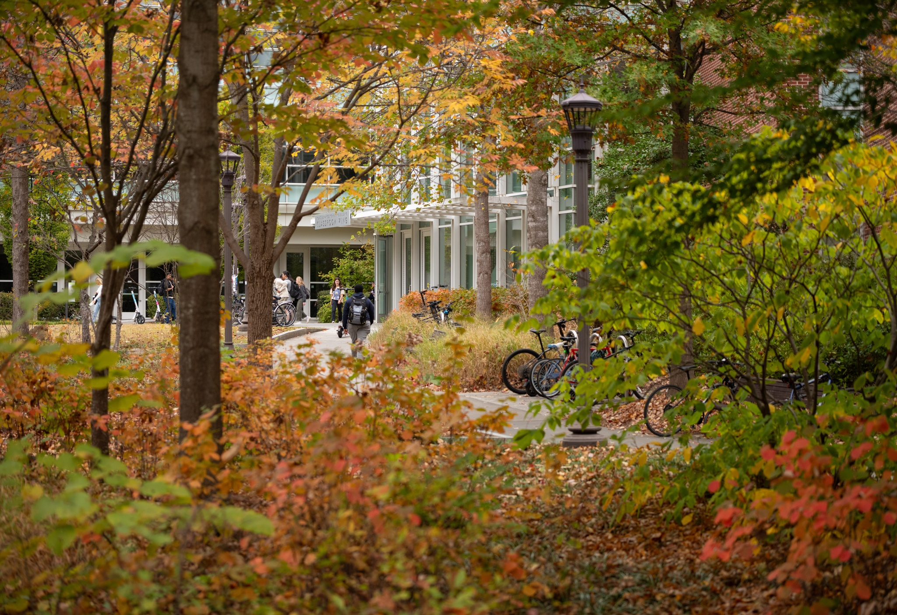

**Question:** Which building is partly obscured by these autumn trees?

**Supplied evidence:** None (image only)

**Answer key:** Klaus Advanced Computing Building. Visible cues: Glass entrance and masonry are heavily obscured by foliage.

**Required points:**
- Identify Klaus Advanced Computing Building; accept these aliases: Klaus, KACB, Christopher W. Klaus Advanced Computing Building.

**Source:** MapEvolve_Images/Klaus/25-R10410-P15-008.jpg

## MEI-LI-022 · landmark_identification · moderate

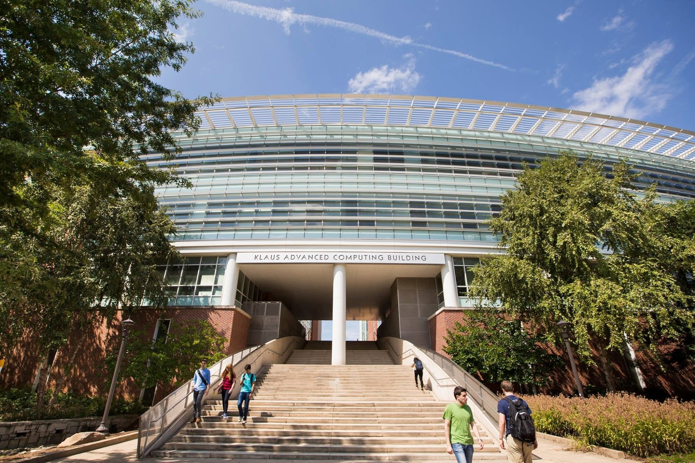

**Question:** Which Georgia Tech computing building is shown beyond the outdoor stairs?

**Supplied evidence:** None (image only)

**Answer key:** Klaus Advanced Computing Building. Visible cues: Broad curved glass facade above an outdoor staircase.

**Required points:**
- Identify Klaus Advanced Computing Building; accept these aliases: Klaus, KACB, Christopher W. Klaus Advanced Computing Building.

**Source:** MapEvolve_Images/Pilot_Pairs/M1_A.jpg

## MEI-LI-023 · landmark_identification · easy

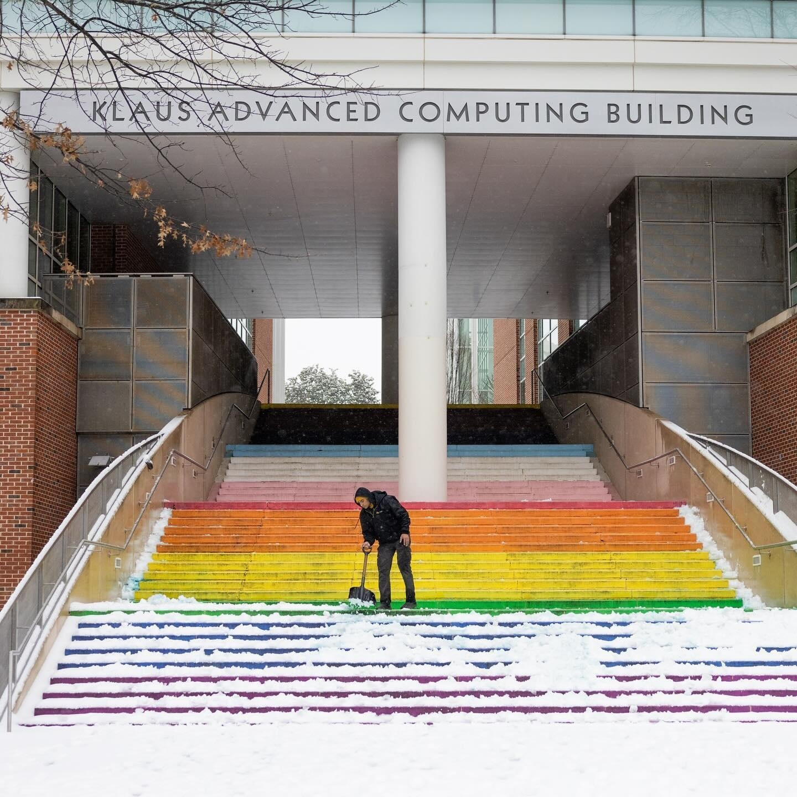

**Question:** What is the building name above this rainbow-colored staircase?

**Supplied evidence:** None (image only)

**Answer key:** Klaus Advanced Computing Building. Visible cues: Klaus Advanced Computing Building lettering over the steps.

**Required points:**
- Identify Klaus Advanced Computing Building; accept these aliases: Klaus, KACB, Christopher W. Klaus Advanced Computing Building.

**Source:** MapEvolve_Images/Pilot_Pairs/M1_B.jpg

## MEI-LI-024 · landmark_identification · hard

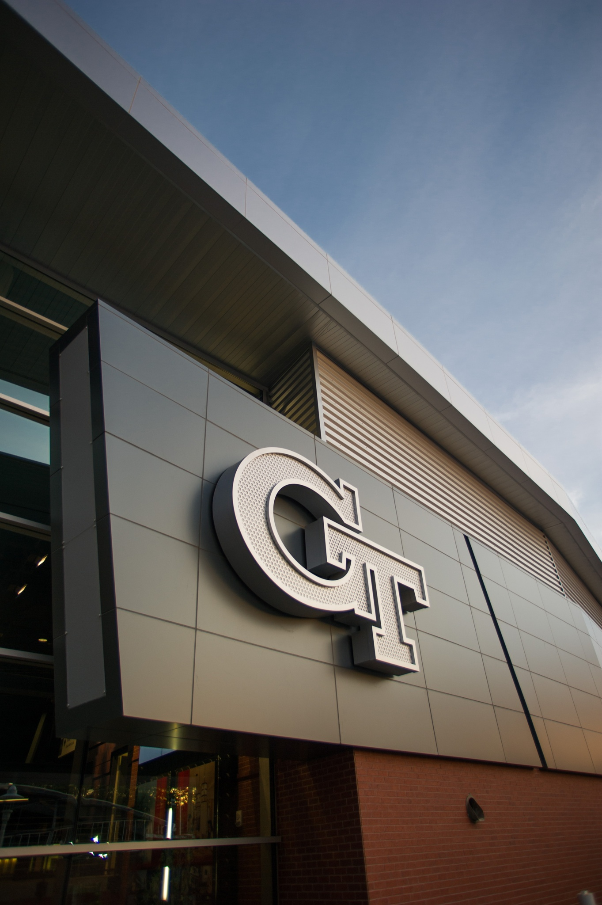

**Question:** Which Georgia Tech venue is shown in this close exterior view?

**Supplied evidence:** None (image only)

**Answer key:** McCamish Pavilion. Visible cues: GT logo and partial arena facade; venue name is outside the frame.

**Required points:**
- Identify McCamish Pavilion; accept these aliases: Hank McCamish Pavilion.

**Source:** MapEvolve_Images/McCamish_Pavilion/13C4114-P1-001.jpg

## MEI-LI-025 · landmark_identification · easy

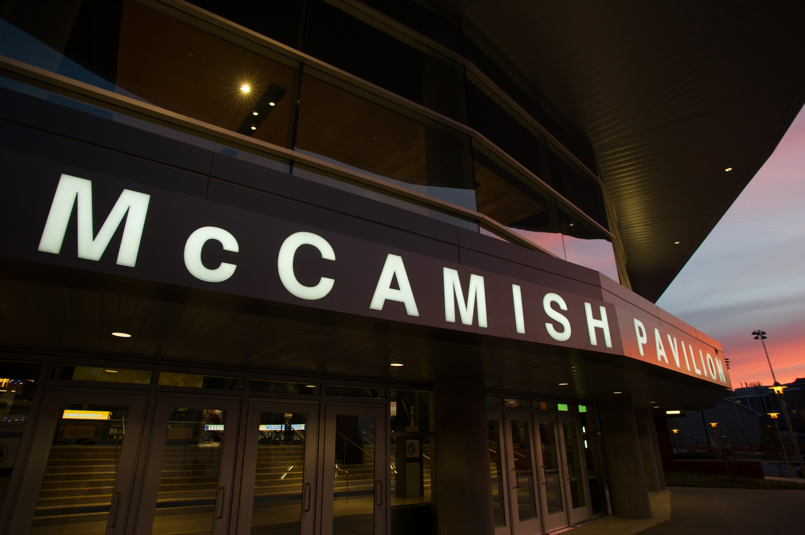

**Question:** Which arena is named on this entrance canopy?

**Supplied evidence:** None (image only)

**Answer key:** McCamish Pavilion. Visible cues: McCamish Pavilion lettering on the entrance.

**Required points:**
- Identify McCamish Pavilion; accept these aliases: Hank McCamish Pavilion.

**Source:** MapEvolve_Images/McCamish_Pavilion/13C4114-P1-011.jpg

## MEI-LI-026 · landmark_identification · easy

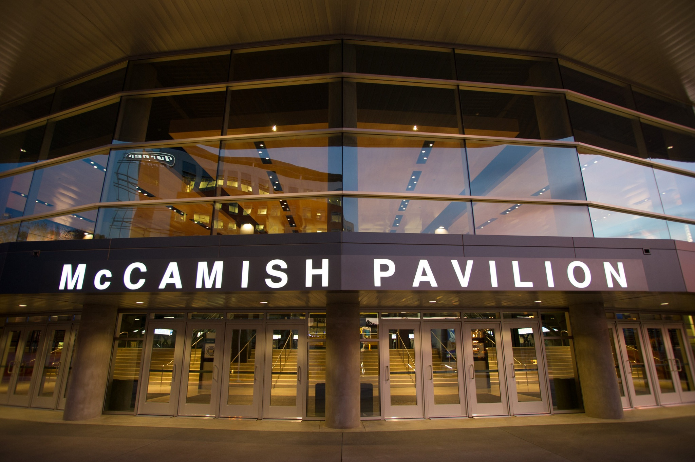

**Question:** Name the building with this curved glass entrance.

**Supplied evidence:** None (image only)

**Answer key:** McCamish Pavilion. Visible cues: McCamish Pavilion entrance lettering and curved facade.

**Required points:**
- Identify McCamish Pavilion; accept these aliases: Hank McCamish Pavilion.

**Source:** MapEvolve_Images/McCamish_Pavilion/13C4114-P1-014.jpg

## MEI-LI-027 · landmark_identification · moderate

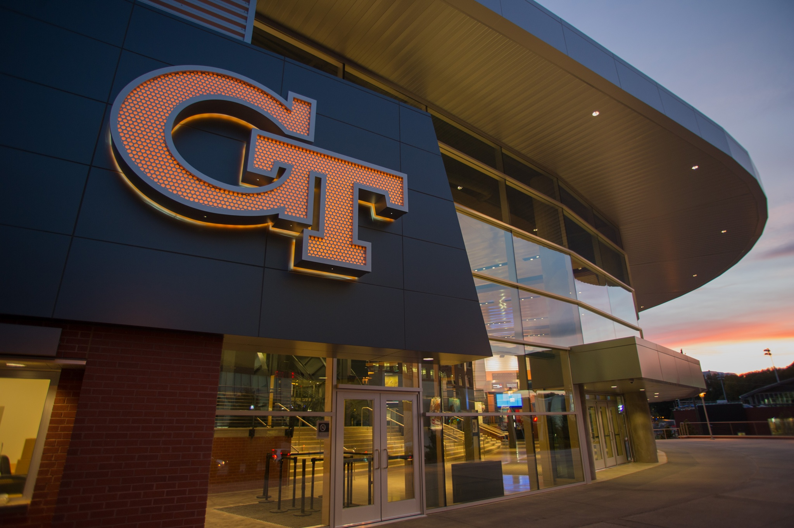

**Question:** Which Georgia Tech arena has this entrance with the large GT logo?

**Supplied evidence:** None (image only)

**Answer key:** McCamish Pavilion. Visible cues: Large GT logo and curved arena entrance.

**Required points:**
- Identify McCamish Pavilion; accept these aliases: Hank McCamish Pavilion.

**Source:** MapEvolve_Images/McCamish_Pavilion/13C4114-P1-015.jpg

## MEI-LI-028 · landmark_identification · moderate

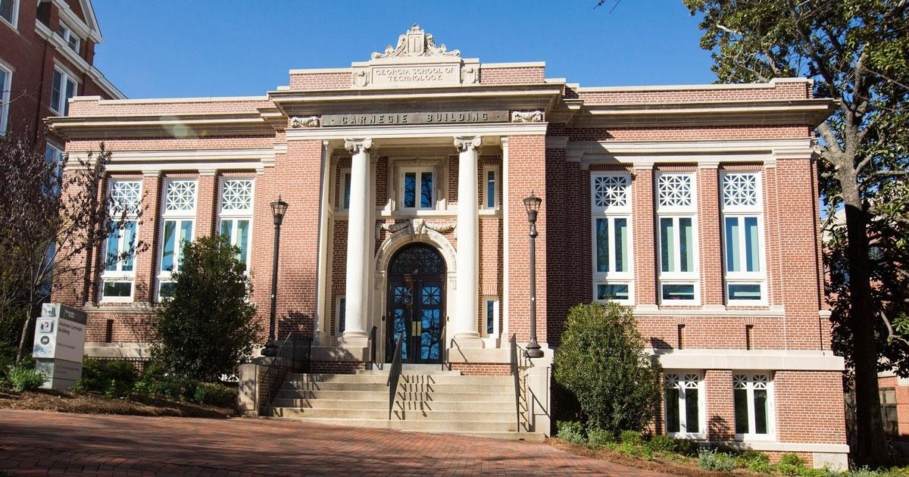

**Question:** Which historic campus building has this columned entrance?

**Supplied evidence:** None (image only)

**Answer key:** Carnegie Building. Visible cues: Red-brick facade, pale classical columns and central entrance.

**Required points:**
- Identify Carnegie Building; accept these aliases: Andrew Carnegie Building, Carnegie Library.

**Source:** MapEvolve_Images/Pilot_Pairs/H2_A.jpg

## MEI-LI-029 · landmark_identification · moderate

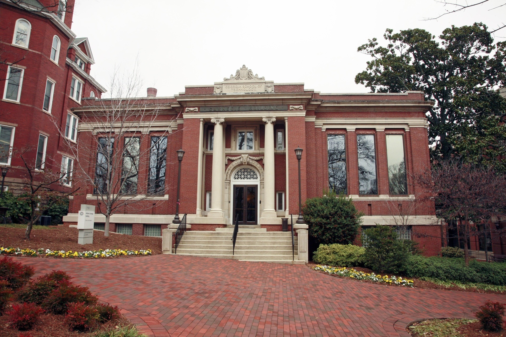

**Question:** Identify this red-brick building with the classical portico.

**Supplied evidence:** None (image only)

**Answer key:** Carnegie Building. Visible cues: Carnegie facade and central columned portico.

**Required points:**
- Identify Carnegie Building; accept these aliases: Andrew Carnegie Building, Carnegie Library.

**Source:** MapEvolve_Images/Pilot_Pairs/H2_B.jpg

## MEI-LI-030 · landmark_identification · easy

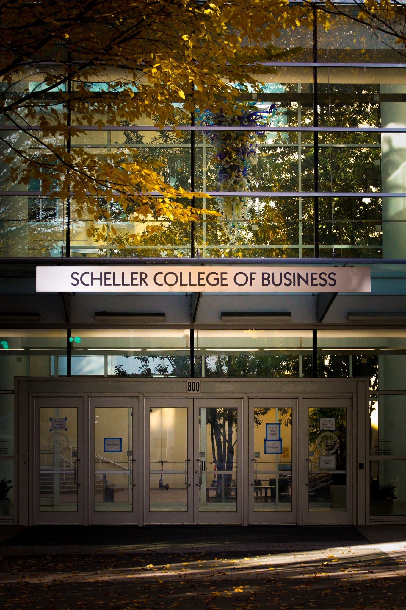

**Question:** Which college building is named over these entrance doors?

**Supplied evidence:** None (image only)

**Answer key:** Scheller College of Business building. Visible cues: Scheller College of Business lettering.

**Required points:**
- Identify Scheller College of Business building; accept these aliases: Scheller College of Business, Georgia Tech College of Management building.

**Source:** MapEvolve_Images/Scheller_College/22C10400-P3-036.JPG

## MEI-LI-031 · landmark_identification · moderate

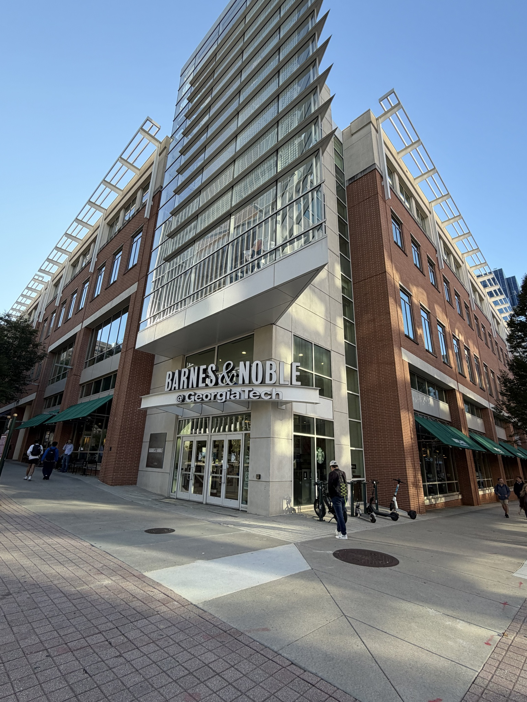

**Question:** Which Georgia Tech college occupies this street-corner building?

**Supplied evidence:** None (image only)

**Answer key:** Scheller College of Business building. Visible cues: Older brick-and-glass Tech Square business building, distinct from the new towers.

**Required points:**
- Identify Scheller College of Business building; accept these aliases: Scheller College of Business, Georgia Tech College of Management building.

**Source:** MapEvolve_Images/Test Sample/IMG_0214.jpeg

## MEI-LI-032 · landmark_identification · hard

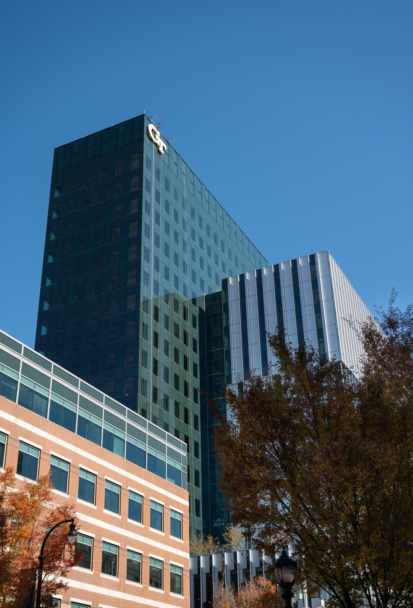

**Question:** What is the name of the taller dark-glass tower in the background?

**Supplied evidence:** None (image only)

**Answer key:** George Tower. Visible cues: Tall dark-glass George Tower behind the shorter finned tower.

**Required points:**
- Identify George Tower; accept these aliases: Bill and Penny George Tower.

**Source:** MapEvolve_Images/Scheller_Tower/26-R10410-P58-001.jpg

## MEI-LI-033 · landmark_identification · moderate

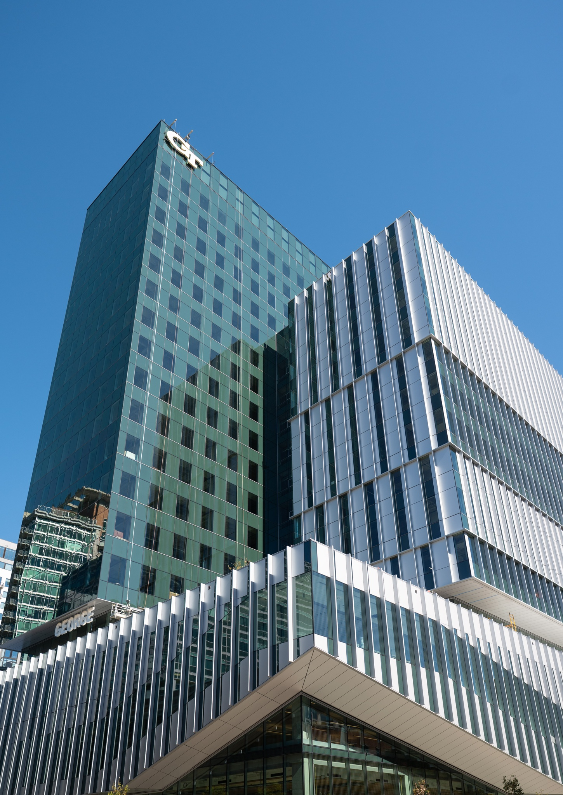

**Question:** Name the shorter white-finned tower in the foreground.

**Supplied evidence:** None (image only)

**Answer key:** Scheller Tower. Visible cues: Scheller Tower has prominent white vertical fins; taller George Tower is behind.

**Required points:**
- Identify Scheller Tower; accept these aliases: .

**Source:** MapEvolve_Images/Scheller_Tower/26-R10410-P58-002.jpg

## MEI-LI-034 · landmark_identification · easy

**Question:** Which tower is named by the large lettering on this facade?

**Supplied evidence:** None (image only)

**Answer key:** Scheller Tower. Visible cues: SCHELLER lettering on the white-finned tower.

**Required points:**
- Identify Scheller Tower; accept these aliases: .

**Source:** MapEvolve_Images/Scheller_Tower/26-R10410-P58-004.jpg

## MEI-LI-035 · landmark_identification · moderate

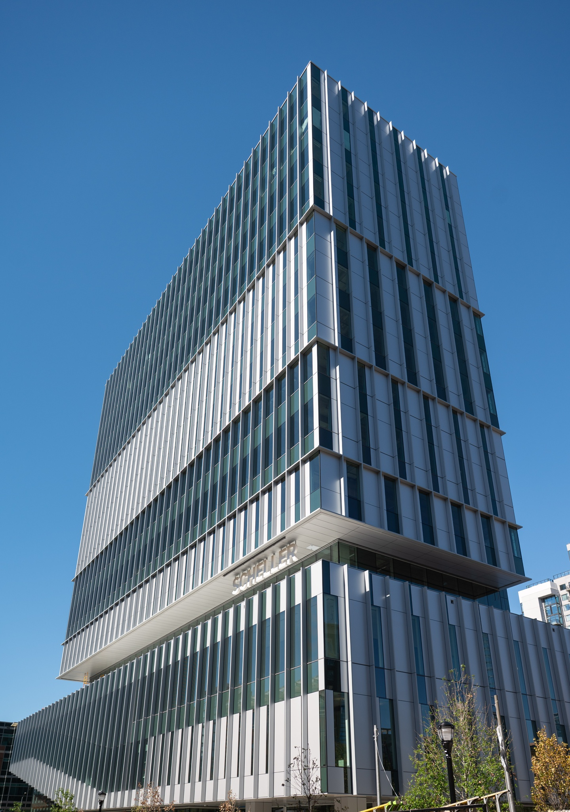

**Question:** Identify the angular white-finned tower shown from the street.

**Supplied evidence:** None (image only)

**Answer key:** Scheller Tower. Visible cues: Stacked projecting volumes and vertical white fins.

**Required points:**
- Identify Scheller Tower; accept these aliases: .

**Source:** MapEvolve_Images/Scheller_Tower/26-R10410-P58-005.jpg

## MEI-LI-036 · landmark_identification · easy

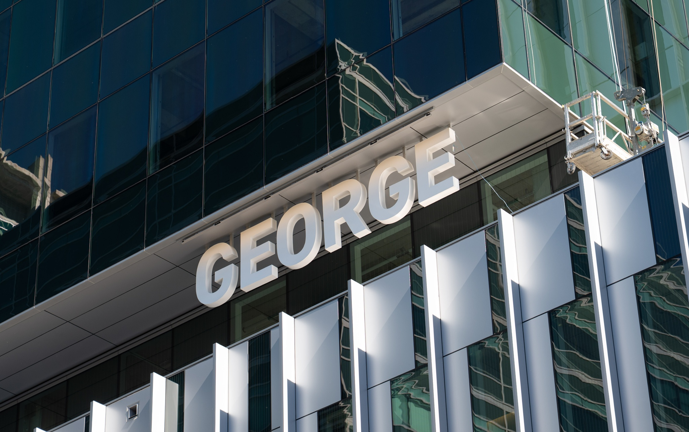

**Question:** Which tower is identified by the lettering in this photograph?

**Supplied evidence:** None (image only)

**Answer key:** George Tower. Visible cues: GEORGE lettering on the facade.

**Required points:**
- Identify George Tower; accept these aliases: Bill and Penny George Tower.

**Source:** MapEvolve_Images/Scheller_Tower/26-R10410-P58-007.jpg

## MEI-LI-037 · landmark_identification · hard

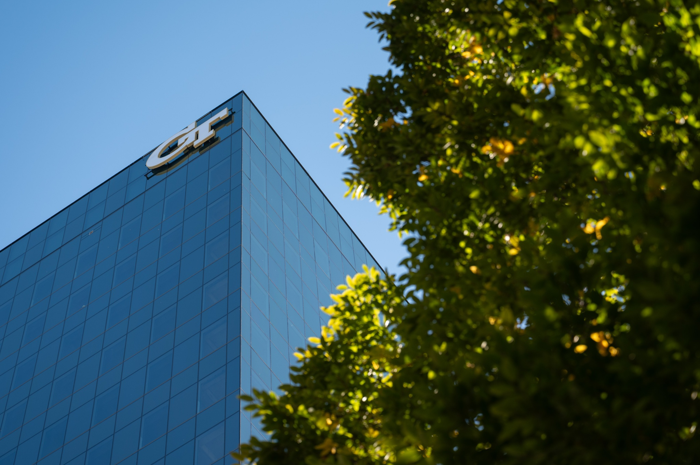

**Question:** Can this close-up of a GT logo alone establish the exact building name?

**Supplied evidence:** None (image only)

**Answer key:** Exact building cannot be established from this close-up alone. The GT logo establishes Georgia Tech affiliation, not a unique building identity.

**Required points:**
- State that the exact building is not established by this close-up.
- Do not turn the GT logo into a unique building identification.

**Source:** MapEvolve_Images/Scheller_Tower/26-R10410-P58-009.jpg

## MEI-LI-038 · landmark_identification · easy

**Question:** Which landmark has these large TECH letters below its roof?

**Supplied evidence:** None (image only)

**Answer key:** Tech Tower. Visible cues: TECH letters on red brick below a pointed roof.

**Required points:**
- Identify Tech Tower; accept these aliases: Lettie Pate Whitehead Evans Administration Building, Evans Administration Building.

**Source:** MapEvolve_Images/Tech_Tower/0624103-P27_63.jpg

## MEI-LI-039 · landmark_identification · moderate

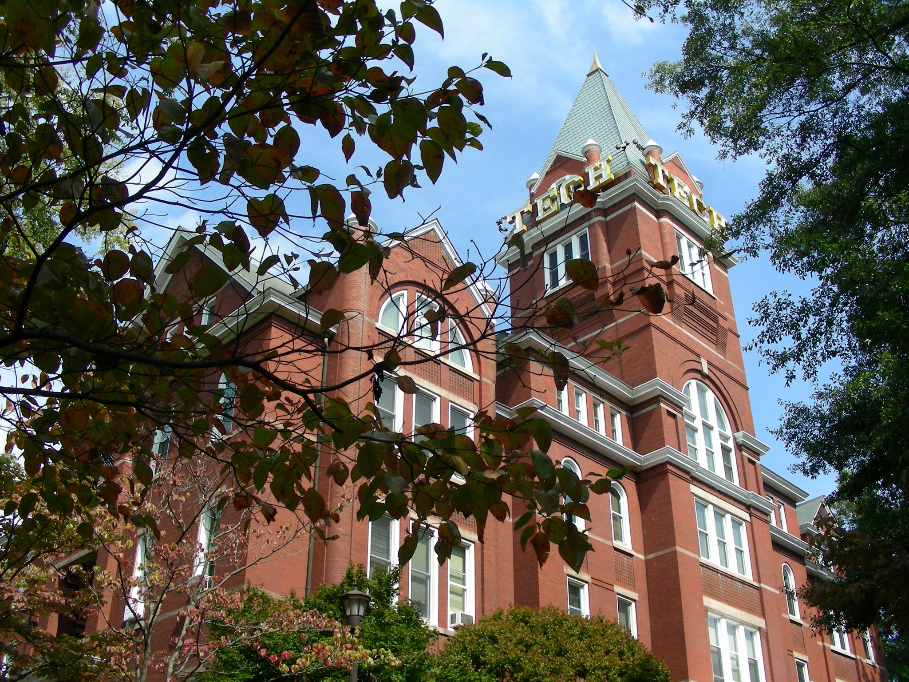

**Question:** Which red-brick campus landmark is visible through the trees?

**Supplied evidence:** None (image only)

**Answer key:** Tech Tower. Visible cues: Historic brick tower, arched windows and TECH letters.

**Required points:**
- Identify Tech Tower; accept these aliases: Lettie Pate Whitehead Evans Administration Building, Evans Administration Building.

**Source:** MapEvolve_Images/Tech_Tower/0701006-P1-1.jpg

## MEI-LI-040 · landmark_identification · hard

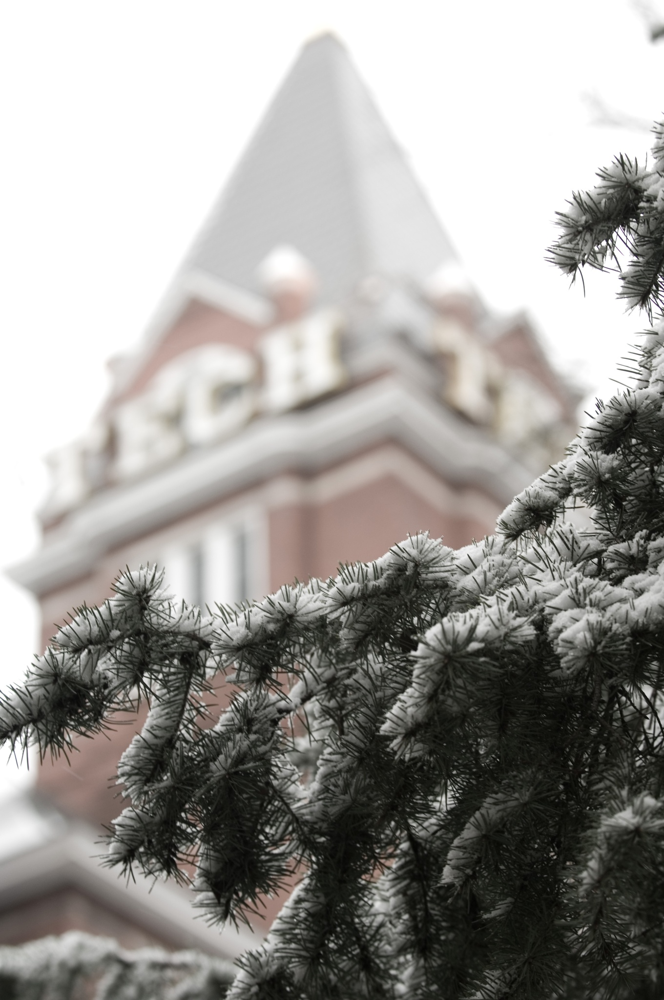

**Question:** Which landmark is suggested by this blurred winter view? Give a tentative identification if needed.

**Supplied evidence:** None (image only)

**Answer key:** Tech Tower. Visible cues: Blurred pointed tower, red brick and pale trim.

**Required points:**
- Identify Tech Tower; accept these aliases: Lettie Pate Whitehead Evans Administration Building, Evans Administration Building.

**Source:** MapEvolve_Images/Tech_Tower/08C1004-P56-151.jpg

## MEI-LI-041 · landmark_identification · easy

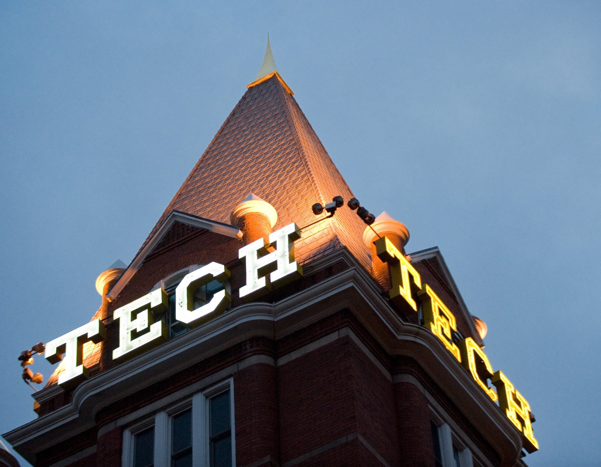

**Question:** Name this landmark with illuminated TECH letters.

**Supplied evidence:** None (image only)

**Answer key:** Tech Tower. Visible cues: TECH letters below the steep tower roof.

**Required points:**
- Identify Tech Tower; accept these aliases: Lettie Pate Whitehead Evans Administration Building, Evans Administration Building.

**Source:** MapEvolve_Images/Tech_Tower/10P1000-P22-008.jpg

## MEI-LI-042 · landmark_identification · moderate

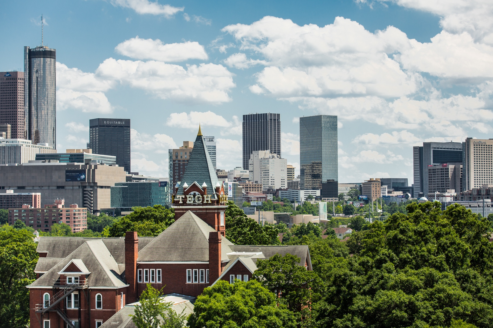

**Question:** Identify the historic red-brick tower in the foreground, rather than the skyline behind it.

**Supplied evidence:** None (image only)

**Answer key:** Tech Tower. Visible cues: TECH lettering and pointed roof on the foreground brick tower.

**Required points:**
- Identify Tech Tower; accept these aliases: Lettie Pate Whitehead Evans Administration Building, Evans Administration Building.

**Source:** MapEvolve_Images/Tech_Tower/13C10000-P14-013.jpg

## MEI-LI-043 · landmark_identification · hard

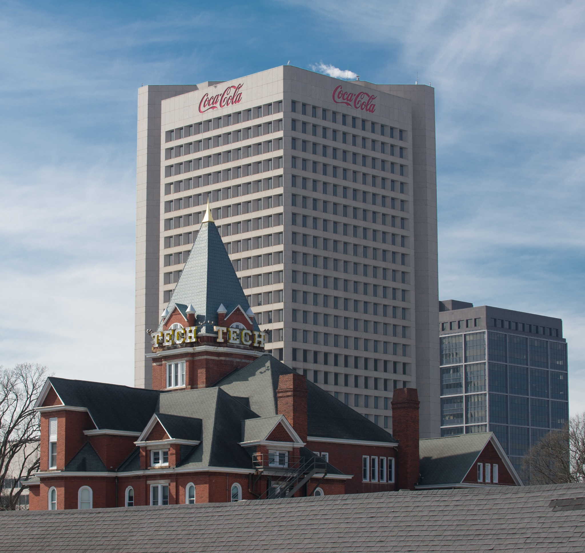

**Question:** Name the historic pointed-roof landmark in front of the large modern high-rise.

**Supplied evidence:** None (image only)

**Answer key:** Tech Tower. Visible cues: Brick tower and TECH lettering below the modern high-rise.

**Required points:**
- Identify Tech Tower; accept these aliases: Lettie Pate Whitehead Evans Administration Building, Evans Administration Building.

**Source:** MapEvolve_Images/Tech_Tower/14C6001-P20-001.jpg

## MEI-LI-044 · landmark_identification · moderate

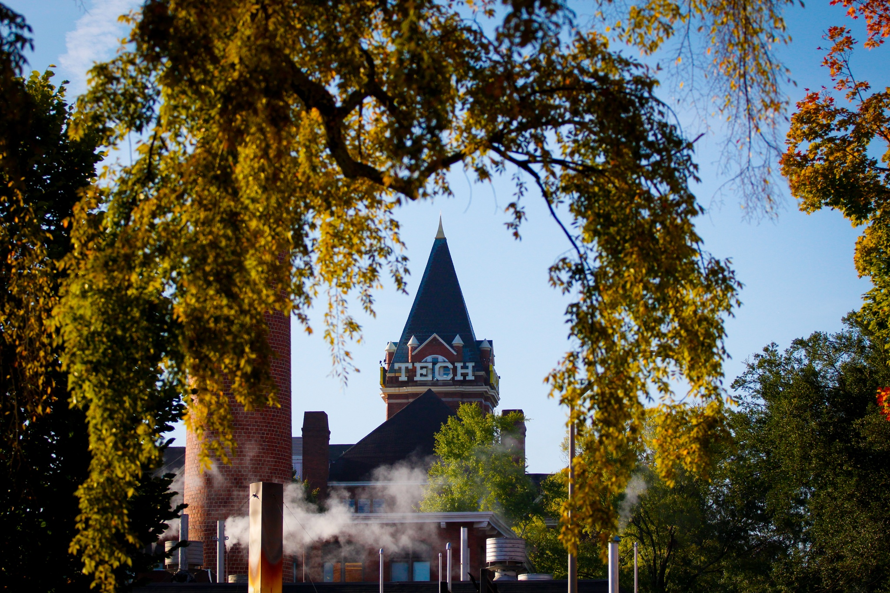

**Question:** Which campus landmark is framed by the autumn branches?

**Supplied evidence:** None (image only)

**Answer key:** Tech Tower. Visible cues: TECH lettering and pointed slate roof.

**Required points:**
- Identify Tech Tower; accept these aliases: Lettie Pate Whitehead Evans Administration Building, Evans Administration Building.

**Source:** MapEvolve_Images/Tech_Tower/22C10400-P3-003.JPG

## MEI-LI-045 · landmark_identification · hard

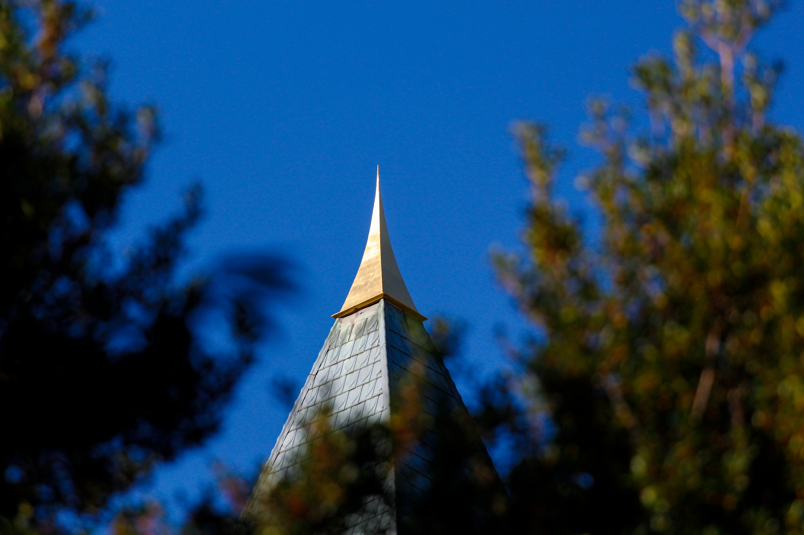

**Question:** Which landmark is represented by this isolated pointed rooftop?

**Supplied evidence:** None (image only)

**Answer key:** Tech Tower. Visible cues: Pyramidal slate roof and gold tip; most of the building is cropped out.

**Required points:**
- Identify Tech Tower; accept these aliases: Lettie Pate Whitehead Evans Administration Building, Evans Administration Building.

**Source:** MapEvolve_Images/Tech_Tower/22C10400-P3-005.JPG

## MEI-LI-046 · landmark_identification · hard

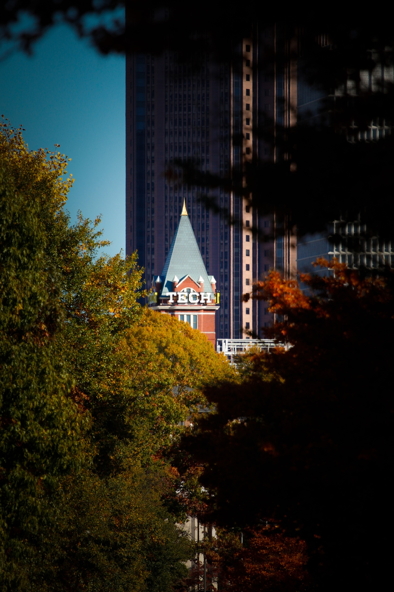

**Question:** Identify the small historic tower framed by the dark foreground.

**Supplied evidence:** None (image only)

**Answer key:** Tech Tower. Visible cues: Small but readable TECH letters on a pointed brick tower.

**Required points:**
- Identify Tech Tower; accept these aliases: Lettie Pate Whitehead Evans Administration Building, Evans Administration Building.

**Source:** MapEvolve_Images/Tech_Tower/22C10400-P3-039.JPG

## MEI-LI-047 · landmark_identification · moderate

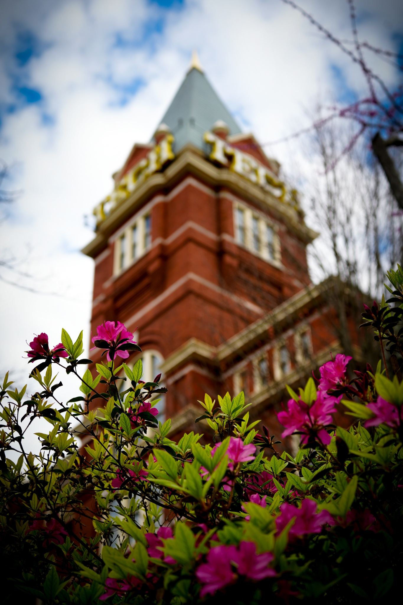

**Question:** Which landmark is shown above the flowering branches?

**Supplied evidence:** None (image only)

**Answer key:** Tech Tower. Visible cues: Brick tower, arched windows and steep roof.

**Required points:**
- Identify Tech Tower; accept these aliases: Lettie Pate Whitehead Evans Administration Building, Evans Administration Building.

**Source:** MapEvolve_Images/Tech_Tower/24-R10400-P49-012.JPG

## MEI-LI-048 · landmark_identification · easy

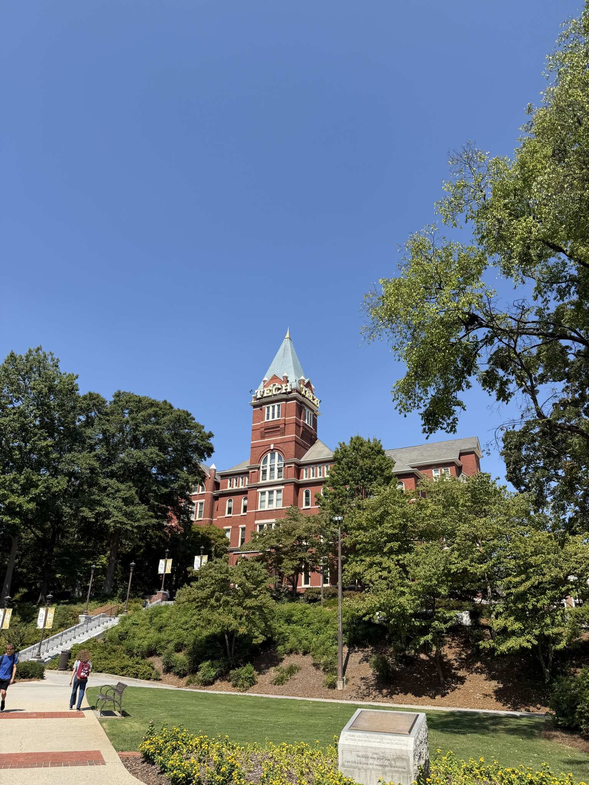

**Question:** What is the name of the red-brick tower at the top of this landscaped slope?

**Supplied evidence:** None (image only)

**Answer key:** Tech Tower. Visible cues: Tech Tower silhouette and TECH letters.

**Required points:**
- Identify Tech Tower; accept these aliases: Lettie Pate Whitehead Evans Administration Building, Evans Administration Building.

**Source:** MapEvolve_Images/Test Sample/IMG_0108.jpeg

## MEI-LI-049 · landmark_identification · moderate

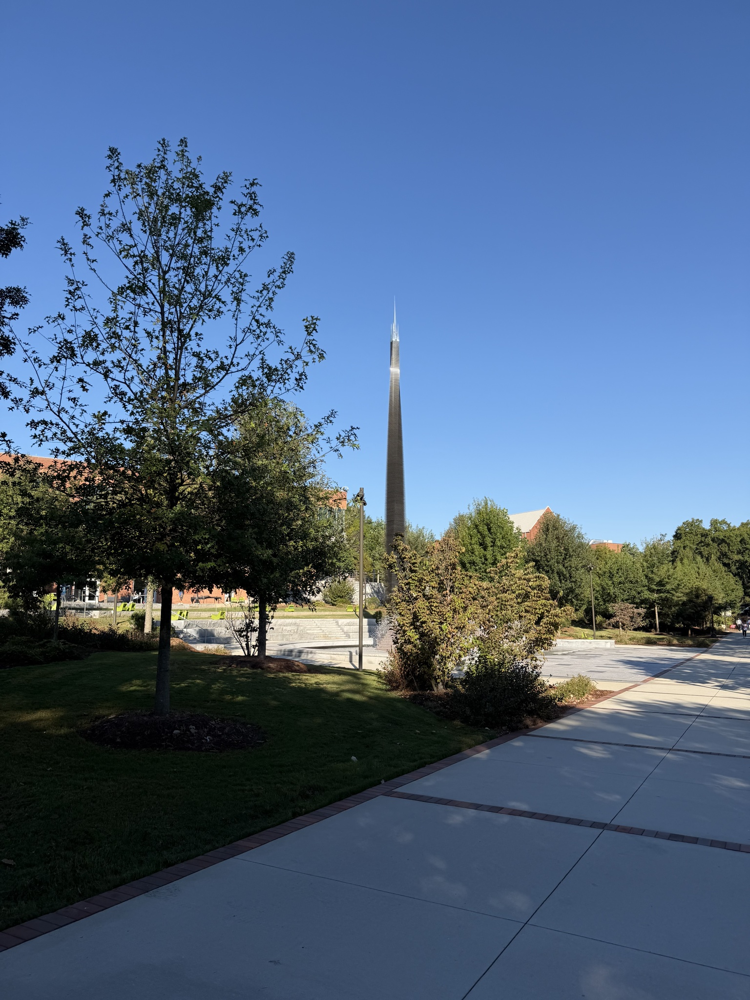

**Question:** Name the slender freestanding landmark at the end of this path.

**Supplied evidence:** None (image only)

**Answer key:** Kessler Campanile. Visible cues: Thin metal spire in the plaza beyond the trees.

**Required points:**
- Identify Kessler Campanile; accept these aliases: Kessler Campanile Fountain.

**Source:** MapEvolve_Images/Test Sample/IMG_0229.jpeg

## MEI-LI-050 · landmark_identification · easy

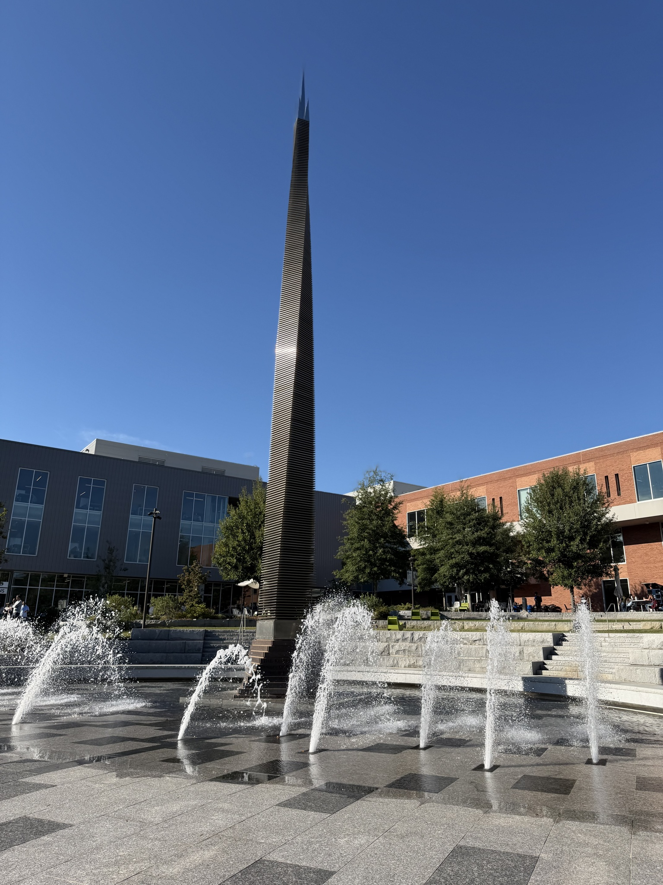

**Question:** Which campus landmark rises above the fountain jets?

**Supplied evidence:** None (image only)

**Answer key:** Kessler Campanile. Visible cues: Metal campanile surrounded by fountain jets.

**Required points:**
- Identify Kessler Campanile; accept these aliases: Kessler Campanile Fountain.

**Source:** MapEvolve_Images/Test Sample/IMG_0234.jpeg

## MEI-FR-001 · factual_retrieval · easy

**Question:** What is the full official name of this landmark, according to the supplied record?

**Supplied evidence:** Building record (paraphrased from https://facilities.gatech.edu/sites/default/files/2023-05/histpresplan.pdf): Tech Tower is the Lettie Pate Whitehead Evans Administration Building. Completed in 1888, it was designed by Bruce and Morgan in the Romanesque Revival style. Its historical roles included teaching and administration.

**Answer key:** Lettie Pate Whitehead Evans Administration Building.

**Required points:**
- Lettie Pate Whitehead Evans Administration Building

**Source:** https://facilities.gatech.edu/sites/default/files/2023-05/histpresplan.pdf

## MEI-FR-002 · factual_retrieval · easy

**Question:** According to the record, in which year was this building completed?

**Supplied evidence:** Building record (paraphrased from https://facilities.gatech.edu/sites/default/files/2023-05/histpresplan.pdf): Tech Tower is the Lettie Pate Whitehead Evans Administration Building. Completed in 1888, it was designed by Bruce and Morgan in the Romanesque Revival style. Its historical roles included teaching and administration.

**Answer key:** 1888.

**Required points:**
- 1888

**Source:** https://facilities.gatech.edu/sites/default/files/2023-05/histpresplan.pdf

## MEI-FR-003 · factual_retrieval · moderate

**Question:** Who designed the pictured landmark, and what architectural style does the record assign it?

**Supplied evidence:** Building record (paraphrased from https://facilities.gatech.edu/sites/default/files/2023-05/histpresplan.pdf): Tech Tower is the Lettie Pate Whitehead Evans Administration Building. Completed in 1888, it was designed by Bruce and Morgan in the Romanesque Revival style. Its historical roles included teaching and administration.

**Answer key:** Bruce and Morgan; Romanesque Revival.

**Required points:**
- Bruce and Morgan
- Romanesque Revival

**Source:** https://facilities.gatech.edu/sites/default/files/2023-05/histpresplan.pdf

## MEI-FR-004 · factual_retrieval · hard

**Question:** Tell me about this building in two sentences: include its official name, completion year, designers and style from the record.

**Supplied evidence:** Building record (paraphrased from https://facilities.gatech.edu/sites/default/files/2023-05/histpresplan.pdf): Tech Tower is the Lettie Pate Whitehead Evans Administration Building. Completed in 1888, it was designed by Bruce and Morgan in the Romanesque Revival style. Its historical roles included teaching and administration.

**Answer key:** Lettie Pate Whitehead Evans Administration Building; 1888; Bruce and Morgan; Romanesque Revival.

**Required points:**
- Lettie Pate Whitehead Evans Administration Building
- 1888
- Bruce and Morgan
- Romanesque Revival

**Source:** https://facilities.gatech.edu/sites/default/files/2023-05/histpresplan.pdf

## MEI-FR-005 · factual_retrieval · easy

**Question:** In which year did the building open, according to the supplied record?

**Supplied evidence:** Building record (paraphrased from https://ce.gatech.edu/node/7514): The G. Wayne Clough Undergraduate Learning Commons opened for the fall 2011 semester. It honors former Georgia Tech president G. Wayne Clough and adjoins Price Gilbert Library. It supports undergraduate learning.

**Answer key:** 2011.

**Required points:**
- 2011

**Source:** https://ce.gatech.edu/node/7514

## MEI-FR-006 · factual_retrieval · easy

**Question:** Whom does this building honor, according to the record?

**Supplied evidence:** Building record (paraphrased from https://ce.gatech.edu/node/7514): The G. Wayne Clough Undergraduate Learning Commons opened for the fall 2011 semester. It honors former Georgia Tech president G. Wayne Clough and adjoins Price Gilbert Library. It supports undergraduate learning.

**Answer key:** G. Wayne Clough; Former Georgia Tech president.

**Required points:**
- G. Wayne Clough
- Former Georgia Tech president

**Source:** https://ce.gatech.edu/node/7514

## MEI-FR-007 · factual_retrieval · moderate

**Question:** Tell me about this building: give its name, opening year and academic purpose using the record.

**Supplied evidence:** Building record (paraphrased from https://ce.gatech.edu/node/7514): The G. Wayne Clough Undergraduate Learning Commons opened for the fall 2011 semester. It honors former Georgia Tech president G. Wayne Clough and adjoins Price Gilbert Library. It supports undergraduate learning.

**Answer key:** Clough Undergraduate Learning Commons; 2011; Undergraduate learning.

**Required points:**
- Clough Undergraduate Learning Commons
- 2011
- Undergraduate learning

**Source:** https://ce.gatech.edu/node/7514

## MEI-FR-008 · factual_retrieval · moderate

**Question:** Which library does this building adjoin, and in which semester did it open?

**Supplied evidence:** Building record (paraphrased from https://ce.gatech.edu/node/7514): The G. Wayne Clough Undergraduate Learning Commons opened for the fall 2011 semester. It honors former Georgia Tech president G. Wayne Clough and adjoins Price Gilbert Library. It supports undergraduate learning.

**Answer key:** Price Gilbert Library; Fall 2011.

**Required points:**
- Price Gilbert Library
- Fall 2011

**Source:** https://ce.gatech.edu/node/7514

## MEI-FR-009 · factual_retrieval · easy

**Question:** What year was this building substantially completed and softly launched?

**Supplied evidence:** Building record (paraphrased from https://livingbuilding.gatech.edu/about): The Kendeda Building for Innovative Sustainable Design reached substantial completion and soft launch in fall 2019. Classes began in January 2020; Living Building Challenge certification followed in March 2021. Lord Aeck Sargent and The Miller Hull Partnership led architecture; Skanska USA built it.

**Answer key:** 2019.

**Required points:**
- 2019

**Source:** https://livingbuilding.gatech.edu/about

## MEI-FR-010 · factual_retrieval · moderate

**Question:** When did classes begin here, and when did Living Building Challenge certification follow?

**Supplied evidence:** Building record (paraphrased from https://livingbuilding.gatech.edu/about): The Kendeda Building for Innovative Sustainable Design reached substantial completion and soft launch in fall 2019. Classes began in January 2020; Living Building Challenge certification followed in March 2021. Lord Aeck Sargent and The Miller Hull Partnership led architecture; Skanska USA built it.

**Answer key:** January 2020; March 2021.

**Required points:**
- January 2020
- March 2021

**Source:** https://livingbuilding.gatech.edu/about

## MEI-FR-011 · factual_retrieval · moderate

**Question:** Name the two architecture firms and the builder listed for this building.

**Supplied evidence:** Building record (paraphrased from https://livingbuilding.gatech.edu/about): The Kendeda Building for Innovative Sustainable Design reached substantial completion and soft launch in fall 2019. Classes began in January 2020; Living Building Challenge certification followed in March 2021. Lord Aeck Sargent and The Miller Hull Partnership led architecture; Skanska USA built it.

**Answer key:** Lord Aeck Sargent; The Miller Hull Partnership; Skanska USA.

**Required points:**
- Lord Aeck Sargent
- The Miller Hull Partnership
- Skanska USA

**Source:** https://livingbuilding.gatech.edu/about

## MEI-FR-012 · factual_retrieval · hard

**Question:** Tell me about this building using the record: distinguish its soft launch, first classes and certification dates.

**Supplied evidence:** Building record (paraphrased from https://livingbuilding.gatech.edu/about): The Kendeda Building for Innovative Sustainable Design reached substantial completion and soft launch in fall 2019. Classes began in January 2020; Living Building Challenge certification followed in March 2021. Lord Aeck Sargent and The Miller Hull Partnership led architecture; Skanska USA built it.

**Answer key:** Kendeda Building for Innovative Sustainable Design; Fall 2019 soft launch; January 2020 first classes; March 2021 certification.

**Required points:**
- Kendeda Building for Innovative Sustainable Design
- Fall 2019 soft launch
- January 2020 first classes
- March 2021 certification

**Source:** https://livingbuilding.gatech.edu/about

## MEI-FR-013 · factual_retrieval · hard

**Question:** A caption says this building opened in 2021. Is that accurate? Separate completion, classroom occupancy and certification.

**Supplied evidence:** Building record (paraphrased from https://livingbuilding.gatech.edu/about): The Kendeda Building for Innovative Sustainable Design reached substantial completion and soft launch in fall 2019. Classes began in January 2020; Living Building Challenge certification followed in March 2021. Lord Aeck Sargent and The Miller Hull Partnership led architecture; Skanska USA built it.

**Answer key:** 2019 substantial completion/soft launch; 2020 classes; 2021 certification, not original opening.

**Required points:**
- 2019 substantial completion/soft launch
- 2020 classes
- 2021 certification, not original opening

**Source:** https://livingbuilding.gatech.edu/about

## MEI-FR-014 · factual_retrieval · easy

**Question:** Who designed this landmark, according to the record?

**Supplied evidence:** Building record (paraphrased from https://arts.gatech.edu/public-art/kessler-campanile): The Kessler Campanile is an 80-foot stainless-steel landmark designed by Richard Hill. It was constructed for the 1996 Olympics and stands between the John Lewis Student Center and Tech Green.

**Answer key:** Richard Hill.

**Required points:**
- Richard Hill

**Source:** https://arts.gatech.edu/public-art/kessler-campanile

## MEI-FR-015 · factual_retrieval · easy

**Question:** For which event and year was this landmark constructed?

**Supplied evidence:** Building record (paraphrased from https://arts.gatech.edu/public-art/kessler-campanile): The Kessler Campanile is an 80-foot stainless-steel landmark designed by Richard Hill. It was constructed for the 1996 Olympics and stands between the John Lewis Student Center and Tech Green.

**Answer key:** 1996 Olympics.

**Required points:**
- 1996 Olympics

**Source:** https://arts.gatech.edu/public-art/kessler-campanile

## MEI-FR-016 · factual_retrieval · moderate

**Question:** Tell me about this landmark: name it and give its material and height from the record.

**Supplied evidence:** Building record (paraphrased from https://arts.gatech.edu/public-art/kessler-campanile): The Kessler Campanile is an 80-foot stainless-steel landmark designed by Richard Hill. It was constructed for the 1996 Olympics and stands between the John Lewis Student Center and Tech Green.

**Answer key:** Kessler Campanile; Stainless steel; 80 feet.

**Required points:**
- Kessler Campanile
- Stainless steel
- 80 feet

**Source:** https://arts.gatech.edu/public-art/kessler-campanile

## MEI-FR-017 · factual_retrieval · moderate

**Question:** Which two campus places does the record place this landmark between?

**Supplied evidence:** Building record (paraphrased from https://arts.gatech.edu/public-art/kessler-campanile): The Kessler Campanile is an 80-foot stainless-steel landmark designed by Richard Hill. It was constructed for the 1996 Olympics and stands between the John Lewis Student Center and Tech Green.

**Answer key:** John Lewis Student Center; Tech Green.

**Required points:**
- John Lewis Student Center
- Tech Green

**Source:** https://arts.gatech.edu/public-art/kessler-campanile

## MEI-FR-018 · factual_retrieval · easy

**Question:** On what date did this building officially open, according to the record?

**Supplied evidence:** Building record (paraphrased from https://sites.cc.gatech.edu/compiler/archive/compiler-november06.html): The Klaus Advanced Computing Building officially opened with a ribbon-cutting on October 26, 2006. A gift from Christopher Klaus made it possible. It supports computing research, including robotics, supercomputing and information security.

**Answer key:** October 26, 2006.

**Required points:**
- October 26, 2006

**Source:** https://sites.cc.gatech.edu/compiler/archive/compiler-november06.html

## MEI-FR-019 · factual_retrieval · moderate

**Question:** Who provided the gift supporting this building, and what is one research field it supports?

**Supplied evidence:** Building record (paraphrased from https://sites.cc.gatech.edu/compiler/archive/compiler-november06.html): The Klaus Advanced Computing Building officially opened with a ribbon-cutting on October 26, 2006. A gift from Christopher Klaus made it possible. It supports computing research, including robotics, supercomputing and information security.

**Answer key:** Christopher Klaus; At least one of robotics, supercomputing or information security.

**Required points:**
- Christopher Klaus
- At least one of robotics, supercomputing or information security

**Source:** https://sites.cc.gatech.edu/compiler/archive/compiler-november06.html

## MEI-FR-020 · factual_retrieval · hard

**Question:** Summarize the record for this building: include its name, opening date, benefactor and two research fields.

**Supplied evidence:** Building record (paraphrased from https://sites.cc.gatech.edu/compiler/archive/compiler-november06.html): The Klaus Advanced Computing Building officially opened with a ribbon-cutting on October 26, 2006. A gift from Christopher Klaus made it possible. It supports computing research, including robotics, supercomputing and information security.

**Answer key:** Klaus Advanced Computing Building; October 26, 2006; Christopher Klaus; Any two of robotics, supercomputing, information security.

**Required points:**
- Klaus Advanced Computing Building
- October 26, 2006
- Christopher Klaus
- Any two of robotics, supercomputing, information security

**Source:** https://sites.cc.gatech.edu/compiler/archive/compiler-november06.html

## MEI-FR-021 · factual_retrieval · easy

**Question:** In what year was this dining hall originally constructed?

**Supplied evidence:** Building record (paraphrased from https://www.gatech.edu/news/2026/08/12/brittain-dining-hall-reopening-following-two-year-renovation): Brittain Dining Hall was originally constructed in 1928. Its 2026 reopening followed a two-year renovation. Collegiate Gothic features in its exterior and main dining room were retained while kitchens, service areas and systems were modernized.

**Answer key:** 1928.

**Required points:**
- 1928

**Source:** https://www.gatech.edu/news/2026/08/12/brittain-dining-hall-reopening-following-two-year-renovation

## MEI-FR-022 · factual_retrieval · moderate

**Question:** Which architectural style was retained, and in what year did the dining hall reopen after renovation?

**Supplied evidence:** Building record (paraphrased from https://www.gatech.edu/news/2026/08/12/brittain-dining-hall-reopening-following-two-year-renovation): Brittain Dining Hall was originally constructed in 1928. Its 2026 reopening followed a two-year renovation. Collegiate Gothic features in its exterior and main dining room were retained while kitchens, service areas and systems were modernized.

**Answer key:** Collegiate Gothic; 2026.

**Required points:**
- Collegiate Gothic
- 2026

**Source:** https://www.gatech.edu/news/2026/08/12/brittain-dining-hall-reopening-following-two-year-renovation

## MEI-FR-023 · factual_retrieval · hard

**Question:** Tell me about the dining hall: distinguish its original construction from its recent renovation and name two kinds of modernized facilities.

**Supplied evidence:** Building record (paraphrased from https://www.gatech.edu/news/2026/08/12/brittain-dining-hall-reopening-following-two-year-renovation): Brittain Dining Hall was originally constructed in 1928. Its 2026 reopening followed a two-year renovation. Collegiate Gothic features in its exterior and main dining room were retained while kitchens, service areas and systems were modernized.

**Answer key:** Brittain Dining Hall; 1928 construction; 2026 reopening; Any two: kitchens, service areas, systems.

**Required points:**
- Brittain Dining Hall
- 1928 construction
- 2026 reopening
- Any two: kitchens, service areas, systems

**Source:** https://www.gatech.edu/news/2026/08/12/brittain-dining-hall-reopening-following-two-year-renovation

## MEI-FR-024 · factual_retrieval · easy

**Question:** For which sport is this venue used, and who is its namesake?

**Supplied evidence:** Building record (paraphrased from https://ramblinwreck.com/facilities/mccamish-pavilion): McCamish Pavilion is Georgia Tech's basketball arena, named for Hank McCamish. Its first men's game was November 9, 2012 against Tulane. It occupies the former Alexander Memorial Coliseum site at 10th and Fowler Streets. The renovation included a rectangular seating bowl and upper deck.

**Answer key:** Basketball; Hank McCamish.

**Required points:**
- Basketball
- Hank McCamish

**Source:** https://ramblinwreck.com/facilities/mccamish-pavilion

## MEI-FR-025 · factual_retrieval · moderate

**Question:** When was the first men's game here under the McCamish name, and who was the opponent?

**Supplied evidence:** Building record (paraphrased from https://ramblinwreck.com/facilities/mccamish-pavilion): McCamish Pavilion is Georgia Tech's basketball arena, named for Hank McCamish. Its first men's game was November 9, 2012 against Tulane. It occupies the former Alexander Memorial Coliseum site at 10th and Fowler Streets. The renovation included a rectangular seating bowl and upper deck.

**Answer key:** November 9, 2012; Tulane.

**Required points:**
- November 9, 2012
- Tulane

**Source:** https://ramblinwreck.com/facilities/mccamish-pavilion

## MEI-FR-026 · factual_retrieval · hard

**Question:** Tell me about this arena using the record: give its name, predecessor and two seating changes.

**Supplied evidence:** Building record (paraphrased from https://ramblinwreck.com/facilities/mccamish-pavilion): McCamish Pavilion is Georgia Tech's basketball arena, named for Hank McCamish. Its first men's game was November 9, 2012 against Tulane. It occupies the former Alexander Memorial Coliseum site at 10th and Fowler Streets. The renovation included a rectangular seating bowl and upper deck.

**Answer key:** McCamish Pavilion; Alexander Memorial Coliseum; Rectangular seating bowl; Upper deck.

**Required points:**
- McCamish Pavilion
- Alexander Memorial Coliseum
- Rectangular seating bowl
- Upper deck

**Source:** https://ramblinwreck.com/facilities/mccamish-pavilion

## MEI-FR-027 · factual_retrieval · easy

**Question:** In what year was this former library built?

**Supplied evidence:** Building record (paraphrased from https://provost.gatech.edu/news/renewal-gets-real-library-next-site): The Carnegie Building was built in 1907 as Georgia Tech's first purpose-built library.

**Answer key:** 1907.

**Required points:**
- 1907

**Source:** https://provost.gatech.edu/news/renewal-gets-real-library-next-site

## MEI-FR-028 · factual_retrieval · moderate

**Question:** What was this building's original role, and what was its construction year?

**Supplied evidence:** Building record (paraphrased from https://provost.gatech.edu/news/renewal-gets-real-library-next-site): The Carnegie Building was built in 1907 as Georgia Tech's first purpose-built library.

**Answer key:** First purpose-built Georgia Tech library; 1907.

**Required points:**
- First purpose-built Georgia Tech library
- 1907

**Source:** https://provost.gatech.edu/news/renewal-gets-real-library-next-site

## MEI-FR-029 · factual_retrieval · hard

**Question:** According to the record, which programs use the pictured tower, how many stories does it have, and when were the complex's first three floors scheduled to open?

**Supplied evidence:** Building record (paraphrased from https://news.gatech.edu/news/2026/01/07/tech-square-3-reaches-major-milestone): Tech Square 3 is named George Tower | Scheller Tower. Its first three floors were scheduled to open January 12, 2026. The 14-story Scheller Tower houses graduate and executive business programs; the 18-story George Tower houses the H. Milton Stewart School of Industrial and Systems Engineering.

**Answer key:** Graduate and executive business programs; 14 stories; January 12, 2026.

**Required points:**
- Graduate and executive business programs
- 14 stories
- January 12, 2026

**Source:** https://news.gatech.edu/news/2026/01/07/tech-square-3-reaches-major-milestone

## MEI-FR-030 · factual_retrieval · hard

**Question:** Identify the tower named in this picture and retrieve its school, story count and companion tower from the record.

**Supplied evidence:** Building record (paraphrased from https://news.gatech.edu/news/2026/01/07/tech-square-3-reaches-major-milestone): Tech Square 3 is named George Tower | Scheller Tower. Its first three floors were scheduled to open January 12, 2026. The 14-story Scheller Tower houses graduate and executive business programs; the 18-story George Tower houses the H. Milton Stewart School of Industrial and Systems Engineering.

**Answer key:** George Tower; H. Milton Stewart School of Industrial and Systems Engineering; 18 stories; Scheller Tower.

**Required points:**
- George Tower
- H. Milton Stewart School of Industrial and Systems Engineering
- 18 stories
- Scheller Tower

**Source:** https://news.gatech.edu/news/2026/01/07/tech-square-3-reaches-major-milestone

## MEI-FR-031 · factual_retrieval · easy

**Question:** According to the supplied capture metadata, which year was this picture taken?

**Supplied evidence:** EXIF extracted from the original image: DateTimeOriginal=2026:08:12 10:05:55. This is a camera metadata record, not independently authenticated.

**Answer key:** The EXIF DateTimeOriginal field records 2026.

**Required points:**
- 2026

**Source:** MapEvolve_Images/Brittain_Dining_Hall/2026-08-12-P1-001.jpg#EXIF:DateTimeOriginal

## MEI-FR-032 · factual_retrieval · easy

**Question:** According to the supplied capture metadata, which year was this picture taken?

**Supplied evidence:** EXIF extracted from the original image: DateTimeOriginal=2012:10:24 09:08:21. This is a camera metadata record, not independently authenticated.

**Answer key:** The EXIF DateTimeOriginal field records 2012.

**Required points:**
- 2012

**Source:** MapEvolve_Images/Clough/13C4114-P1-028.jpg#EXIF:DateTimeOriginal

## MEI-FR-033 · factual_retrieval · easy

**Question:** According to the supplied capture metadata, which year was this picture taken?

**Supplied evidence:** EXIF extracted from the original image: DateTimeOriginal=2019:09:13 19:28:15. This is a camera metadata record, not independently authenticated.

**Answer key:** The EXIF DateTimeOriginal field records 2019.

**Required points:**
- 2019

**Source:** MapEvolve_Images/Kendeda/20C10400-P24-001.jpg#EXIF:DateTimeOriginal

## MEI-FR-034 · factual_retrieval · easy

**Question:** According to the supplied capture metadata, which year was this picture taken?

**Supplied evidence:** EXIF extracted from the original image: DateTimeOriginal=2021:05:11 15:15:31. This is a camera metadata record, not independently authenticated.

**Answer key:** The EXIF DateTimeOriginal field records 2021.

**Required points:**
- 2021

**Source:** MapEvolve_Images/Kendeda/22C10400-P31-001.jpg#EXIF:DateTimeOriginal

## MEI-FR-035 · factual_retrieval · easy

**Question:** According to the supplied capture metadata, which year was this picture taken?

**Supplied evidence:** EXIF extracted from the original image: DateTimeOriginal=2021:10:18 10:55:52. This is a camera metadata record, not independently authenticated.

**Answer key:** The EXIF DateTimeOriginal field records 2021.

**Required points:**
- 2021

**Source:** MapEvolve_Images/Kessler_Campanile/22C10400-P3-008.JPG#EXIF:DateTimeOriginal

## MEI-FR-036 · factual_retrieval · easy

**Question:** According to the supplied capture metadata, which year was this picture taken?

**Supplied evidence:** EXIF extracted from the original image: DateTimeOriginal=2024:11:04 11:57:00. This is a camera metadata record, not independently authenticated.

**Answer key:** The EXIF DateTimeOriginal field records 2024.

**Required points:**
- 2024

**Source:** MapEvolve_Images/Klaus/25-R10410-P15-008.jpg#EXIF:DateTimeOriginal

## MEI-FR-037 · factual_retrieval · moderate

**Question:** Using the supplied record, give the capture date (YYYY-MM-DD). Does the filename prefix establish the capture year?

**Supplied evidence:** Original asset filename: 13C4114-P1-001.jpg; EXIF DateTimeOriginal=2012:10:30 18:42:22. This camera metadata is not independently authenticated.

**Answer key:** The metadata records 2012-10-30. The filename prefix is an asset identifier and does not establish the capture year.

**Required points:**
- 2012-10-30
- Use DateTimeOriginal rather than guessing from the filename prefix.

**Source:** MapEvolve_Images/McCamish_Pavilion/13C4114-P1-001.jpg#EXIF:DateTimeOriginal

## MEI-FR-038 · factual_retrieval · moderate

**Question:** Using the supplied record, give the capture date (YYYY-MM-DD). Does the filename prefix establish the capture year?

**Supplied evidence:** Original asset filename: 22C10400-P3-036.JPG; EXIF DateTimeOriginal=2021:11:10 10:43:51. This camera metadata is not independently authenticated.

**Answer key:** The metadata records 2021-11-10. The filename prefix is an asset identifier and does not establish the capture year.

**Required points:**
- 2021-11-10
- Use DateTimeOriginal rather than guessing from the filename prefix.

**Source:** MapEvolve_Images/Scheller_College/22C10400-P3-036.JPG#EXIF:DateTimeOriginal

## MEI-FR-039 · factual_retrieval · moderate

**Question:** Using the supplied record, give the capture date (YYYY-MM-DD). Does the filename prefix establish the capture year?

**Supplied evidence:** Original asset filename: 26-R10410-P58-001.jpg; EXIF DateTimeOriginal=2025:11:04 13:30:06. This camera metadata is not independently authenticated.

**Answer key:** The metadata records 2025-11-04. The filename prefix is an asset identifier and does not establish the capture year.

**Required points:**
- 2025-11-04
- Use DateTimeOriginal rather than guessing from the filename prefix.

**Source:** MapEvolve_Images/Scheller_Tower/26-R10410-P58-001.jpg#EXIF:DateTimeOriginal

## MEI-FR-040 · factual_retrieval · moderate

**Question:** Using the supplied record, give the capture date (YYYY-MM-DD). Does the filename prefix establish the capture year?

**Supplied evidence:** Original asset filename: 0624103-P27_63.jpg; EXIF DateTimeOriginal=2006:03:21 16:54:35. This camera metadata is not independently authenticated.

**Answer key:** The metadata records 2006-03-21. The filename prefix is an asset identifier and does not establish the capture year.

**Required points:**
- 2006-03-21
- Use DateTimeOriginal rather than guessing from the filename prefix.

**Source:** MapEvolve_Images/Tech_Tower/0624103-P27_63.jpg#EXIF:DateTimeOriginal

## MEI-FR-041 · factual_retrieval · hard

**Question:** Using the supplied record, give the capture date (YYYY-MM-DD). Does the filename prefix establish the capture year?

**Supplied evidence:** Original asset filename: 10P1000-P22-008.jpg; EXIF DateTimeOriginal=2009:10:30 07:45:50. This camera metadata is not independently authenticated.

**Answer key:** The metadata records 2009-10-30. The filename prefix is an asset identifier and does not establish the capture year.

**Required points:**
- 2009-10-30
- Use DateTimeOriginal rather than guessing from the filename prefix.

**Source:** MapEvolve_Images/Tech_Tower/10P1000-P22-008.jpg#EXIF:DateTimeOriginal

## MEI-FR-042 · factual_retrieval · hard

**Question:** Using the supplied record, give the capture date (YYYY-MM-DD). Does the filename prefix establish the capture year?

**Supplied evidence:** Original asset filename: IMG_0108.jpeg; EXIF DateTimeOriginal=2026:09:18 13:01:51. This camera metadata is not independently authenticated.

**Answer key:** The metadata records 2026-09-18. The filename prefix is an asset identifier and does not establish the capture year.

**Required points:**
- 2026-09-18
- Use DateTimeOriginal rather than guessing from the filename prefix.

**Source:** MapEvolve_Images/Test Sample/IMG_0108.jpeg#EXIF:DateTimeOriginal

## MEI-FR-043 · factual_retrieval · hard

**Question:** Which exact year was this photograph taken? Use only the visible image.

**Supplied evidence:** None (image only)

**Answer key:** The exact requested capture year cannot be determined from the supplied photograph alone. A reliable original capture record or relevant external record is needed.

**Required points:**
- Explicitly state that the exact requested fact cannot be established from the image alone.
- Request suitable metadata or records instead of guessing.

**Source:** MapEvolve_Images/Brittain_Dining_Hall/2026-08-12-P1-001.jpg

## MEI-FR-044 · factual_retrieval · hard

**Question:** Can you determine the exact capture year of this photograph from its lighting and architecture alone?

**Supplied evidence:** None (image only)

**Answer key:** The exact requested capture year cannot be determined from the supplied photograph alone. A reliable original capture record or relevant external record is needed.

**Required points:**
- Explicitly state that the exact requested fact cannot be established from the image alone.
- Request suitable metadata or records instead of guessing.

**Source:** MapEvolve_Images/Kendeda/20C10400-P24-001.jpg

## MEI-FR-045 · factual_retrieval · hard

**Question:** The tower looks new. In what exact year was this photograph taken?

**Supplied evidence:** None (image only)

**Answer key:** The exact requested capture year cannot be determined from the supplied photograph alone. A reliable original capture record or relevant external record is needed.

**Required points:**
- Explicitly state that the exact requested fact cannot be established from the image alone.
- Request suitable metadata or records instead of guessing.

**Source:** MapEvolve_Images/Scheller_Tower/26-R10410-P58-001.jpg

## MEI-FR-046 · factual_retrieval · hard

**Question:** Which year was this picture taken? Distinguish the photograph date from the building age.

**Supplied evidence:** None (image only)

**Answer key:** The exact requested capture year cannot be determined from the supplied photograph alone. A reliable original capture record or relevant external record is needed.

**Required points:**
- Explicitly state that the exact requested fact cannot be established from the image alone.
- Request suitable metadata or records instead of guessing.

**Source:** MapEvolve_Images/Tech_Tower/0624103-P27_63.jpg

## MEI-FR-047 · factual_retrieval · hard

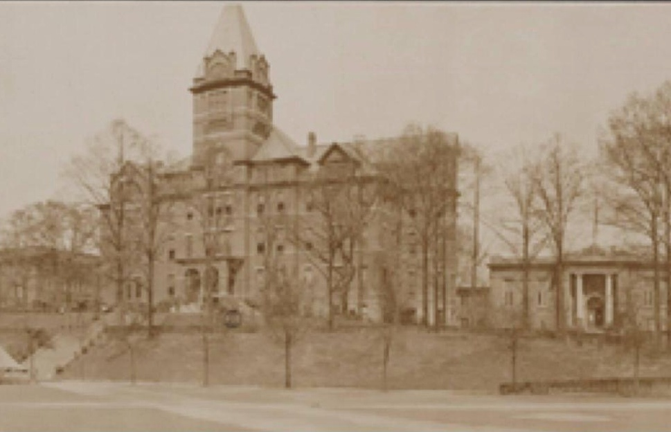

**Question:** Give the exact year this historic photograph was taken, using only the picture.

**Supplied evidence:** None (image only)

**Answer key:** The exact requested capture year cannot be determined from the supplied photograph alone. A reliable original capture record or relevant external record is needed.

**Required points:**
- Explicitly state that the exact requested fact cannot be established from the image alone.
- Request suitable metadata or records instead of guessing.

**Source:** MapEvolve_Images/Pilot_Pairs/H1_B.jpg

## MEI-FR-048 · factual_retrieval · hard

**Question:** What was the exact construction cost of this building? No project records are provided.

**Supplied evidence:** None (image only)

**Answer key:** The exact requested construction cost cannot be determined from the supplied photograph alone. A reliable original capture record or relevant external record is needed.

**Required points:**
- Explicitly state that the exact requested fact cannot be established from the image alone.
- Request suitable metadata or records instead of guessing.

**Source:** MapEvolve_Images/Pilot_Pairs/M1_A.jpg

## MEI-FR-049 · factual_retrieval · hard

**Question:** Who was the photographer, and on what exact date was this photograph taken?

**Supplied evidence:** None (image only)

**Answer key:** The exact requested photographer and date cannot be determined from the supplied photograph alone. A reliable original capture record or relevant external record is needed.

**Required points:**
- Explicitly state that the exact requested fact cannot be established from the image alone.
- Request suitable metadata or records instead of guessing.

**Source:** MapEvolve_Images/Scheller_College/22C10400-P3-036.JPG

## MEI-FR-050 · factual_retrieval · hard

**Question:** What was the exact number of people enrolled in classes in this building on the day of the photo?

**Supplied evidence:** None (image only)

**Answer key:** The exact requested enrollment cannot be determined from the supplied photograph alone. A reliable original capture record or relevant external record is needed.

**Required points:**
- Explicitly state that the exact requested fact cannot be established from the image alone.
- Request suitable metadata or records instead of guessing.

**Source:** MapEvolve_Images/Kendeda/26-R10410-P108-001.JPG
