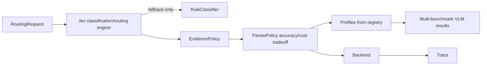

# Unify MapEvolve MVP and Jev adaptive routing

## Intended architecture

Jev is the classification and routing engine. It receives the user query,
available evidence, and request metadata, classifies the request into the
canonical MapEvolve family, and exposes the classification signals needed by
the routing policy. The routing decision must not be inferred from image
folder names, model output, or a VLM self-report. A deterministic rule-based
classifier remains only as an explicit offline/error fallback when Jev is
unavailable; it is not the primary router.

After Jev classifies a request, MapEvolve selects a VLM from a profile built
from multiple benchmarks. The selected model is not simply the most accurate
model and is not selected by a fixed percentage margin. For the classified
family and request difficulty, the policy compares evaluated accuracy against
estimated request cost on the non-dominated Pareto frontier. A configurable
tradeoff parameter (or an equivalent cost budget/accuracy target) determines
how much accuracy is worth paying for. Every decision records the Jev
classification, profile version, frontier, tradeoff configuration, and
selected model.

## Comparison

Both branches implement the same pipeline: classify, pick a model on cost and quality, call a VLM, write a trace. They differ in what each side built.

| Aspect | MVP (`mapevolve/`, `jev-routing`) | Jev branch (`jev_router/`, `origin/jev-adaptive-routing`) |
| --- | --- | --- |
| Classifier | Regex rules only, 4 families plus `unknown`, `rule_id` trace. No real Jev call. | TypeSafe Jev, 7 typed questions in one call, probabilities, heuristic fallback, leakage guard (`FORBIDDEN_STATE_KEYS`). 5 query types plus difficulty. |
| Selection rule | Pareto frontier, then cheapest within `accuracy_margin` (0.02) of the best accuracy. | Accuracy/cost tradeoff over the non-dominated frontier, with configurable budget, target, or utility mode. Jev probabilities and difficulty can select the relevant family profile. |
| Profile data | Static `model_profiles.json`: accuracy, cost per 1M tokens, image cost. Cost proxy adds token price to image price, which mixes units. | Registry prices plus results from several benchmarks for 10–15 diverse VLMs. Aggregate scores by task/family, retain per-benchmark results and sample counts, and estimate request cost using token/image rates. |
| Evidence and actions | `execute`, `request_evidence` or `abstain` with `capability_not_yet_supported`. | `answer`, `verify_then_answer`, `retrieve_then_answer`, `use_tools`, `decline`. Unbuilt actions are marked `implemented: false`. |
| Backends | `FakeBackend` plus `OpenRouterBackend` (stdlib `urllib`). No failover, by design. | LangChain `ChatOpenRouter`/`ChatOpenAI`, failover, JSON answers, answer-checker cascade (off by default). |
| Extras | Frozen dataclass contracts, dry-run CLI, `unittest`. | Streamlit app, SIFT pair features, learned quality model, datasets, eval scripts, committed results. |
| Dependencies | stdlib only. | `langchain-typesafe` (Python 3.11 or later), langchain, Pillow, OpenCV, Streamlit, pytest. |

### Query taxonomy mapping

The mapping is mostly one to one:
- `cross_view_matching` maps to `same_building_verification`.
- `temporal_comparison` maps to `change_captioning`.
- `factual_retrieval` maps to `evidence_backed_investigation`.
- `spatial_reasoning` maps to `proximity_computation`.
- `landmark_identification` has no MVP family. It maps to `unknown` and abstains until a family is added.

The MVP families stay canonical, because they are the shared contract.

## Borrow, adapt, ignore

**Borrow (port with light edits)**
- Jev question definitions and the leakage guard from `jev_router/classifier.py`. Jev becomes the primary classifier and routing engine. The existing rule classifier is retained only as the offline and failure fallback path, and the trace labels which path ran (`source`).
- Difficulty as a classifier output (`QueryClassification.difficulty`). It lets profiles be keyed by family and difficulty tier later.
- `config/models.yaml` and `config/model_registry.json` as the source of real model IDs, prices and availability. Use them with benchmark manifests to generate `model_profiles.json` instead of the placeholder models. The profile must contain 10–15 VLMs spanning proprietary and open-weight, small and frontier, and different visual-language architectures or serving tiers.
- Task prompt text (`config/prompts/tasks/cross_view_matching.txt` and the v2 system prompt) as the verification prompt in `OpenRouterBackend`.
- Image downscaling (`MAX_LONG_EDGE` = 2048) from `jev_router/vlm.py` for payload building. Keep it optional so the stdlib core does not need Pillow.
- The `datasets/gatech_pilot.json` manifest schema and the per-location split validator, for the profiling and eval set.
- `scripts/evaluate_classifier.py` and `scripts/evaluate_offline.py` ideas for classifier accuracy and routing regret.

**Adapt**
- Policy: replace the fixed margin rule as the primary policy with an explicit accuracy/cost tradeoff over the Pareto frontier. Support a cost budget and minimum accuracy target, or a documented utility form such as `accuracy - lambda * normalized_cost`; reject configurations that do not meet a required accuracy target rather than silently selecting a worse model. Cost becomes an estimate from tokens and images (`default_tokens_per_image`, `default_output_tokens`), which fixes the unit mixing in `total_cost_proxy`.
- Actions: map the Jev action names onto the MVP actions. `answer` becomes `execute`. `retrieve_then_answer` and `use_tools` become `abstain` with `capability_not_yet_supported`. `decline` becomes `abstain`. `verify_then_answer` is out of scope for now.
- Registry shrinkage (`shrinkage_k`) applies only if profiles gain per-difficulty scores. Until there are enough graded cases per cell, retain per-benchmark scores and uncertainty, aggregate conservatively by family, and do not claim that a small pilot establishes a stable ranking.
- Backends: keep the stdlib `OpenRouterBackend`. Optionally add failover later, as an explicit decision recorded in the trace, since "no silent fallback" is an MVP rule.

**Ignore (do not merge to `main`)**
- `app.py` (Streamlit), SIFT `pair_features.py`, `quality_model.py` and `config/quality_model.json`. The learned model gave no gain at 6 cases and needs at least 30.
- The answer-checker cascade (it is off by default, and its AUC was 0.60).
- Committed `results/`, `benchmark/artifacts/`, `benchmark/runs/`, the 6k-line `openrouter_relevant_models.json`, `.DS_Store` and `demo_world` images (39 MB). Keep these on the branch or regenerate them.
- The `jev_router/` package name, the Jev branch's `plan.md` rewrite and its README results tables.
- The Jev branch's arbitrary balanced-mode weights (quality 0.60, cost 0.25, latency 0.15), unless calibrated on held-out routing data and documented as a sensitivity analysis.

## Target structure

- One package, `mapevolve/`. New files: `mapevolve/jev_classifier.py` (primary Jev adapter, imports the SDK lazily) and `mapevolve/profile_builder.py` (turns registry and benchmark manifests into profiles).
- `contracts.py` is a shared contract and must not change without approval. Only additive fields are proposed (`difficulty`, `source`), so approval is needed before T-A.
- Add optional dependencies as extras (`jev`, `app`) so core and CI stay stdlib-only.

## Work queue (sequential, one task card each in `tasks/`)

1. **T06 Reconcile branches.** Rebase or merge `main` into `jev-routing`. Bring over only the allowlisted Jev files into a scratch dir or `docs/`. Add `.gitignore` entries and drop `.DS_Store`. Check with `git merge-tree` that `main`, `jev-routing` and `jev-adaptive-routing` merge without conflicts in `README.md`, `plan.md` and `.gitignore`.
2. **T07 Build the evaluation-backed profile.** Define a benchmark manifest and scoring protocol covering several complementary VLM benchmarks relevant to matching, change understanding, visual question answering, and/or grounded reasoning. Evaluate or import reproducible results for 10–15 diverse VLMs, normalize metrics only where justified, retain per-benchmark scores and sample counts, and aggregate family-level accuracy with uncertainty. Build the cost model from actual input/output token and image prices. Compute the non-dominated accuracy/cost frontier and add tests for budget, target-accuracy, and utility tradeoffs. Acceptance: the profile contains at least 10 models, at least 3 benchmark sources, and a case where changing the cost/accuracy tradeoff changes the selected model.
3. **T08 Make Jev the primary classifier/router.** Add `JevQueryClassifier` with the taxonomy mapping, leakage guard, difficulty/probability outputs, and explicit fallback to rules only when Jev cannot run or returns an invalid classification. Tests use a fake Jev, so there is no network. Classification confidence is recorded and routed through the policy; it must not be confused with VLM task accuracy.
4. **T09 Prompt and image payload.** Port the cross-view prompt and optional downscaling into `OpenRouterBackend`. Dry-run must show the exact payload size and estimated cost.
5. **T10 Eval harness.** Port the pilot manifest and a small `scripts/eval_routing.py` that reports Jev classification accuracy, per-benchmark and aggregate VLM accuracy, realized/estimated cost, frontier coverage, routing regret, sensitivity to the accuracy/cost tradeoff, and savings against always-best and always-cheapest baselines. This is the only task that may call paid APIs, and only after approval. Paid calls must be separated from imported benchmark results and clearly labeled.
6. **T11 Docs and merge.** Update `docs/repository_map.md` and `README.md` (one Quick Start for the MVP, one section on Jev options). Open a PR to `main`.

## Open assumptions

- Core runtime stays stdlib-only, with Jev, Pillow and LangChain as optional extras.
- The initial profile must include 10–15 genuinely diverse VLMs and results from several benchmarks; a six-case pilot is useful for smoke testing but is not sufficient to establish the Pareto curve.
- Benchmark scores are not automatically interchangeable. Record task definitions, splits, metrics, prompts, model versions, evaluator method, date, and sample counts. Do not combine incompatible metrics without an explicit aggregation rule.
- The Pareto curve is conditional on query family and difficulty when evidence supports that granularity. If data are insufficient, use a conservative family-level aggregate and expose its uncertainty.
- The selected model must be reproducible from the profile version, Jev output, cost assumptions, and tradeoff configuration. Do not silently substitute a model because it is cheaper or temporarily available.
- Branch name: the local branch is `jev-routing`. The Jev prototype exists only as `origin/jev-adaptive-routing`.